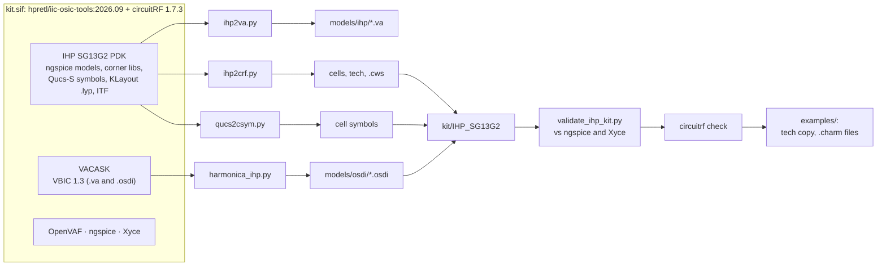

# circuitRF-IHP-SG13G2-PDK

A device kit for [circuitRF](https://github.com/potatobeanradio/circuitRF) on the
[IHP SG13G2](https://github.com/IHP-GmbH/IHP-Open-PDK) open 130 nm SiGe BiCMOS process, the
generator that builds it from the PDK, and example workspaces that use it.

circuitRF can already import the IHP Open PDK itself (File ▸ Manage Libraries). That gives its
parts, but not working HBTs: the PDK's bipolar models are ngspice's built-in VBIC, which circuitRF
does not have. This kit gives circuitRF the SG13G2 devices as parameterised cells. Each cell
evaluates the PDK's own model expressions with VBIC 1.3 and R3 (CMC) compiled to OSDI. The kit is
checked against the PDK in ngspice and Xyce: 120 of 120 comparisons are within tolerance.

| Cell | Device | Parameters |
|---|---|---|
| `npn13G2` | HBT, high fT | Nx, corner, T, dtemp, selft |
| `npn13G2l` | HBT, long emitter | Nx, le, corner, T, dtemp, selft |
| `npn13G2v` | HBT, high breakdown | Nx, le, corner, T, dtemp, selft |
| `rsil`, `rppd`, `rhigh` | poly resistors | w, l, (b), m, corner, T, trise |
| `cap_cmim` | MIM capacitor | w, l, corner, T |

The corner parameter is 0 for typ, 1 for bcs and 2 for wcs. The kit also has:
- **The technology** (`tech/IHP_SG13G2.ctech`): all of KLayout's layers, and an EM stackup for
  circuitRF's planar MoM and 3D solvers.
- **harmonicaRF devices**: the three HBTs compiled whole for harmonicaRF, circuitRF's interactive
  load-pull.


## Requirements

- **Apptainer**, and about 6 GB of disk for the image.
- **circuitRF 1.7.3 or newer** to use the kit. The image carries 1.7.3. Earlier versions crash on
  VBIC: their model worker did not support `$limit` (fixed upstream in 1.7.3).

## Quick start

```bash
apptainer build --fakeroot kit.sif kit.def   # the image: once, ~15 min
./kit.sh generator/build.sh                  # the kit, into kit/IHP_SG13G2: ~1 min, validated
./kit.sh circuitrf examples/.cws             # open the example workspace in circuitRF
```

`kit.sh <command>` runs a command in the image, from this folder, with the image's tools on
`PATH`. Its home directory is `.home/`, so it writes nothing outside this folder.

To start your own project on the kit:

```bash
./kit.sh generator/circuitrf-ihp-workspace my_project
```

That makes a workspace that references the kit and owns a copy of its technology. Every kit cell
placed in it is stored as `ws://IHP_SG13G2/<cell>`, through the alias in the workspace's `.cws`.
If you move the kit, edit that one path.

## The flow



`generator/build.sh` runs the steps in order. It builds into a fresh folder and keeps the previous
kit until every step and check has passed, so a failed build never replaces a working kit.

| Step | Reads | Writes |
|---|---|---|
| copy the compact models | the PDK's `r3_cmc.osdi`; VACASK's `vbic_1p3_5t.osdi` | `models/osdi/` |
| `ihp2va.py`, per HBT and Nx = 1, 2, 4, 8 | `sg13g2_hbt_mod.lib`, `cornerHBT.lib` | `models/ihp/<hbt>_nx<N>.va`: VBIC parameter files for circuitRF's Verilog-A component (*Load Parameters*) |
| `ihp2crf.py` | the PDK's HBT, resistor and capacitor model libraries and corner libraries; KLayout's `sg13g2.lyp`; the ITF | one cell per device (the PDK subcircuit as a schematic: the compact model with the PDK's expressions, plus its parasitics); `tech/IHP_SG13G2.ctech`; the kit's `.cws` and `README.md` |
| `qucs2csym.py` | the PDK's Qucs-S `user_lib` | each cell's symbol, pins in the PDK's terminal order |
| `harmonica_ihp.py osdi`, `nx-osdi` | VACASK's VBIC source, the PDK's HBT model library | `models/osdi/vbic_1p3_bce.osdi` and `npn13G2{,l,v}.osdi`: each HBT compiled whole, with the PDK's scaling inside, for harmonicaRF |
| `validate_ihp_kit.py` | the kit, ngspice, Xyce | `VALIDATION` (below) |
| `circuitrf check` | the kit | the build stops on an error |
| example files | the kit | `examples/tech/` and `examples/harmonica/*.charm` |

`BUILD` in the kit records when the kit was built, from which PDK commit, on which circuitRF, and the
validation result.

### The cells' model paths

A cell names its compiled model as `models/osdi/<model>.osdi`. circuitRF resolves a relative path
in a library cell against the library's root, the folder holding its `.cws`. So a built kit can be
copied or moved as a whole. Validation places every cell from a workspace outside the kit, and a
moved copy validates the same.

### The EM stackup

`tech/IHP_SG13G2.ctech` is built from the PDK's Apache-2.0 sources:

- **From the ITF** (`libs.tech/parasitics/itf/sg13g2_typ.itf`):
  - each metal's thickness and sheet resistance, with σ = 1/(R□·t);
  - each via's resistance and area, with σ = h/(R·A).
- **From the process specification** (`SG13G2_os_process_spec.pdf`, Rev. 1.2):
  - the passivation (1.5 µm oxide, 0.4 µm SiN at εr 6.6);
  - the oxide between the metals (εr 4.1), and the 40 nm MIM film at the εr that gives 1.5 fF/µm²;
  - the silicon: 3.75 µm EPI at 20 Ω·cm, and a 750 µm wafer at 50 Ω·cm, grounded at the backside.
- **Not in either source:** the MIM top plate's and Vmim's conductivity. These take the values from
  IHP's EM workflow, and the code says so.

A workspace owns its copy of the technology, so a thinned die is a change to that copy's
Substrate row.

The stackup as circuitRF's technology editor draws it (Stackup tab; not to scale, so the thin layers
can be read):


## What is checked

`validate_ihp_kit.py` places each cell in a test bench, the way the GUI does, and runs it in
circuitRF. It runs the same device from the PDK's own model files in ngspice, or in Xyce for
harmonic balance.

| What | Against | Tolerance | Rows | Worst |
|---|---|---|---|---|
| HBT Ic and Ib at two VBE, over all three devices, Nx, le, corners and temperature; as kit cells and as the compiled harmonicaRF devices | ngspice | 2 %, or 10 nA | 92 | 5.25 % on a 0.12 µA base current (6.5 nA) |
| Resistor R over w, l, bends, corners | ngspice | 1 % | 9 | 0.08 % |
| MIM capacitor C at 1 GHz, corners | ngspice | 1 % | 3 | 0.00 % |
| npn13G2 common emitter at 10 GHz, Pout over a drive sweep into compression; as a kit cell and as the harmonicaRF device | Xyce | 0.2 dB | 16 | 0.015 dB |

Where the kit and the PDK differ, the cause is VBIC itself:
- The VBIC 1.3 source has a temperature-dependent rth and ngspice's built-in VBIC does not, so
  currents at high power with self-heating differ by up to about 1.5 %.
- At sub-µA base currents, the two differ by a few nA.

The kit is the same on circuitRF 1.7.3 as it was on 1.6.0: all 120 rows are identical.

On every HBT bench, circuitRF notes that the thermal node reaches its reference "only through
1.14E+04 °C/W, which is not a thermal resistance — real values are a few hundred °C/W at most". That
rule of thumb fits parts on a board. A minimum-size SiGe HBT really does have a thermal resistance of
that order, and the value is the PDK's own, so the note can be ignored for these cells.

## Examples

`examples/` is one circuitRF workspace. Its benches, the commands that run them, and what each
one shows are in [examples/README.md](examples/README.md).

The example inductor (IHP's `inductor2` PCell) in circuitRF's 3D view, on its stack. The passivation
and the oxide above the coil are hidden; the oxide between the metals, ILD0, Activ, EPI and the
substrate are shown:


The same model from the front, zoomed to the back end: the TopMetal2 coil, TopVia2, the TopMetal1
underpass and leads, the lumped ports down to Metal1, the layers below Metal1 and the silicon:


## Figures

`docs/make-figures.sh` regenerates every picture circuitRF exports for these pages, in two versions:
- `docs/images/<name>.png`, as circuitRF exports it (data displays have a transparent background);
- `docs/images/white/<name>.png`, on white, which the pages use so they read in a dark theme too.

```bash
./kit.sh docs/make-figures.sh      # after generator/build.sh; it runs the circuit benches first
```

Data displays get white with `--background opaque`. Layouts and schematics take a theme, and
`docs/white.ccolor` is circuitRF's theme with white canvases.

The pictures of circuitRF's window (`docs/images/gui/`) are screenshots of circuitRF 1.7.3 from
`kit.sif`, run on a virtual X display (Xvfb) with Mesa's software rendering, so they need no GPU. The
Messages pane, which shows the machine's paths, was closed before taking them.

## Releases

Pushing a tag `v*` runs `.github/workflows/release.yml`. The workflow builds the kit in the same base
image, validates it, and attaches `circuitRF-IHP-SG13G2-kit-<tag>.tar.gz` to a GitHub release, with
its checksum. The archive is the built `IHP_SG13G2/` folder: unpack it anywhere and reference it from
a workspace (see Quick start). Pushes and pull requests run the same build as a check and keep the
archive as a workflow artifact.

## Using the kit in an IIC-OSIC-TOOLS-based image

[docs/iic-osic-tools-integration.md](docs/iic-osic-tools-integration.md) is the plan for taking the
released kit into an image built from the same IIC-OSIC-TOOLS Docker image (`hpretl/iic-osic-tools`) (circuitRF ≥ 1.7.3, the already-compiled kit, the Palace
wrapper).

## Updating

- **circuitRF:** change the release URL in `kit.def`, rebuild the image, rebuild the kit.
- **The PDK:** change the base image tag and the `COMMIT` check in `kit.def`, then rebuild both.
  `validate_ihp_kit.py` says whether the kit still matches.

## Acknowledgements

- The [IHP Open PDK](https://github.com/IHP-GmbH/IHP-Open-PDK) authors: the models, the layer table, the
  ITF, the process specification, the Qucs-S symbols (Mike Brinson) and the inductor PCell this kit is
  generated from.
- [circuitRF](https://github.com/potatobeanradio/circuitRF), which the kit is for, and whose maintainer
  merged the two fixes the kit needed (released in 1.7.3).
- [IIC-OSIC-TOOLS](https://github.com/iic-jku/IIC-OSIC-TOOLS) (the `hpretl/iic-osic-tools` Docker image, from
  JKU's Institute for Integrated Circuits), the image the kit is built in.
- [VACASK](https://codeberg.org/arpadbuermen/VACASK) for the VBIC 1.3 Verilog-A source, and
  OpenVAF (the image's OpenVAF-reloaded) for compiling it.

**Use of AI.** This repository was developed with an AI coding agent, Claude Code (Anthropic), running
Claude Opus 5.5, directed and reviewed by the maintainer. The agent's work covered the generator changes,
the image, the EM stackup, the examples, the validation and EM runs, the figures and these documents.
Commits it made carry a `Co-Authored-By: Claude Opus 5.5` trailer. The numbers in these pages come from
runs of the code in this repository, and are recorded in the commit messages.

## License

Apache-2.0, as the IHP PDK; see [LICENSE](LICENSE) and [NOTICE](NOTICE).

This repository holds the generator and the examples, not the compiled models. The VBIC-derived
`.osdi` files are built from VACASK's VBIC source, which carries no license header (VACASK is
AGPL-3.0), so they exist only in a built `kit/`, which is not committed, and in the release archives,
which carry the built kit with that note (see NOTICE).
