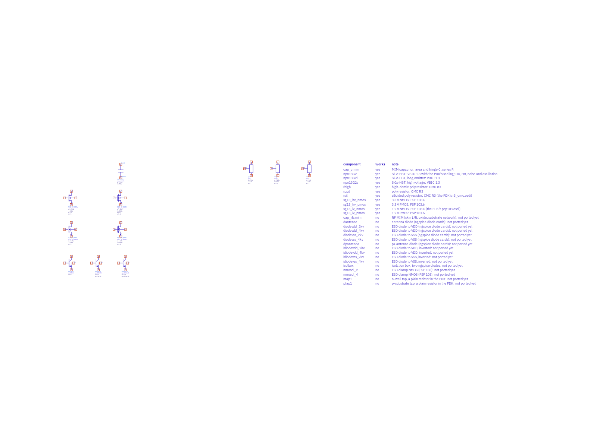
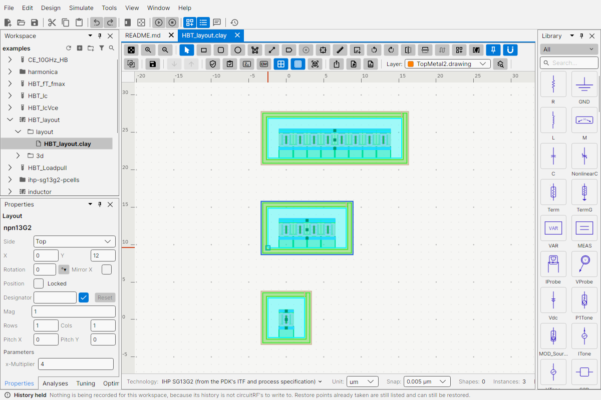
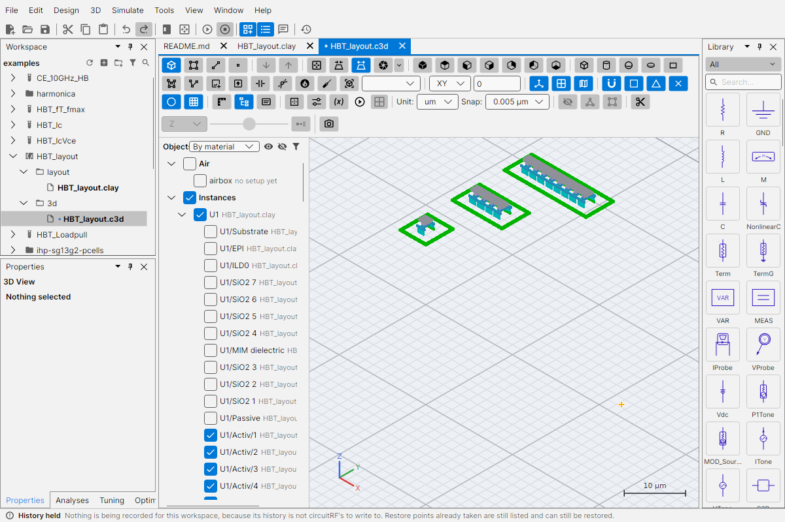
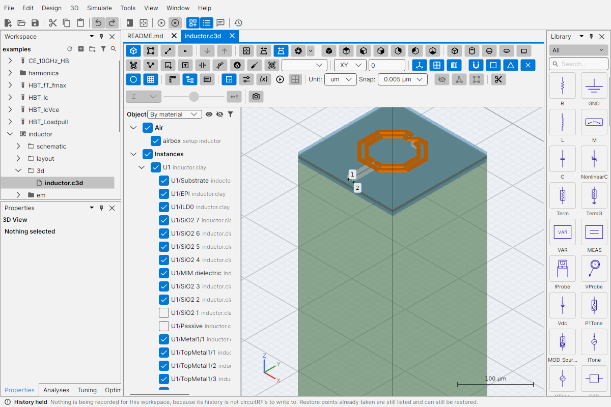
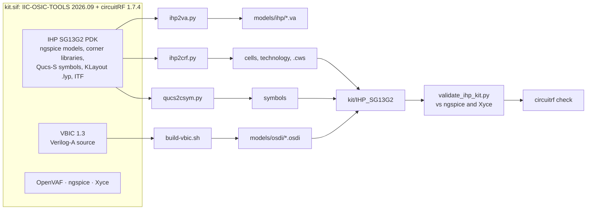
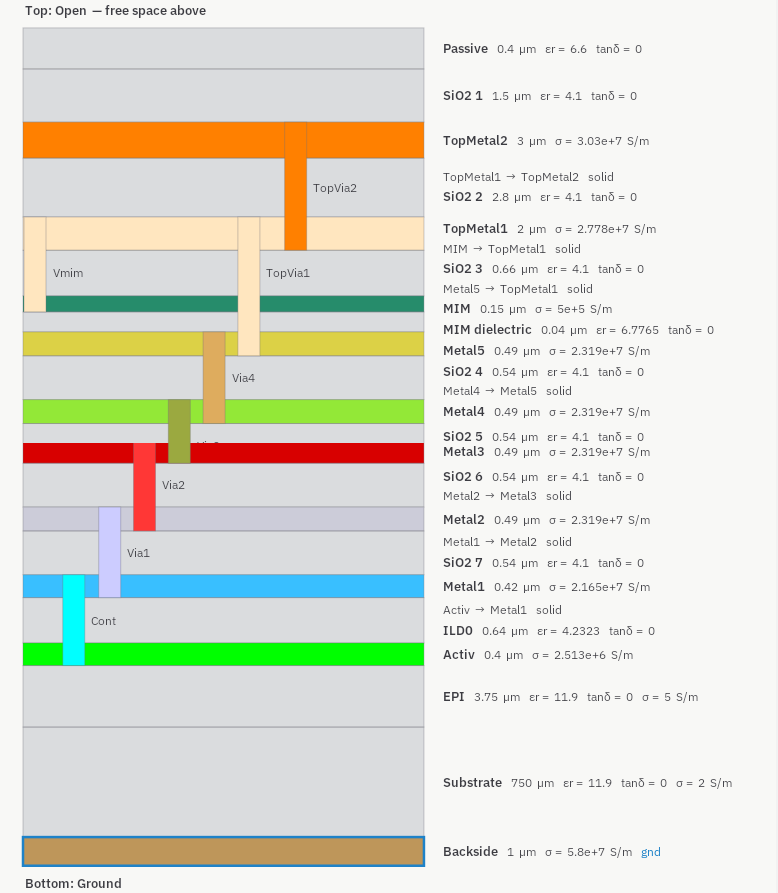
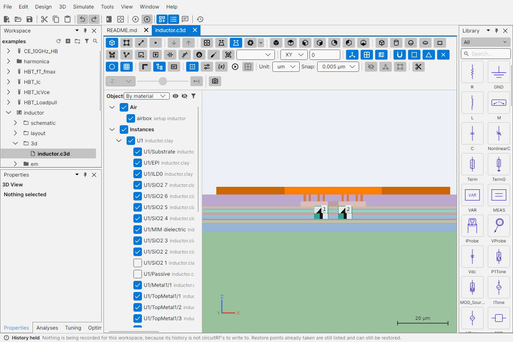
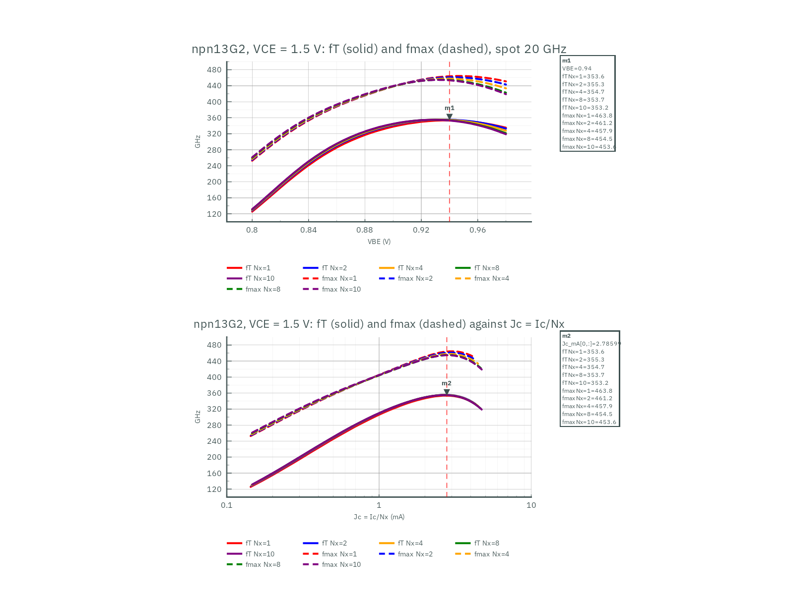

# circuitRF-IHP-SG13G2-PDK: IHP SG13G2 Device Kit for circuitRF

[](LICENSE)
[](https://github.com/aissus/circuitRF-IHP-SG13G2-PDK/actions/workflows/release.yml)


## Description

**circuitRF-IHP-SG13G2-PDK** provides the devices of the [IHP SG13G2](https://github.com/IHP-GmbH/IHP-Open-PDK)
open 130 nm SiGe BiCMOS process as a device kit for [circuitRF](https://github.com/potatobeanradio/circuitRF),
together with the generator that builds it from the PDK and an example workspace.

circuitRF can import the IHP Open PDK directly, but the PDK's bipolar transistors are written for
ngspice's built-in VBIC model, which circuitRF does not have. This kit provides each device as a
parameterised circuitRF cell that evaluates the PDK's own model expressions with compiled Verilog-A
models (VBIC 1.3 for the HBTs, PSP 103 for the MOSFETs, R3 (CMC) for the resistors), with IHP's Qucs-S
symbols. Every build is validated against the PDK's models in ngspice and Xyce (143 comparisons).

| Cell | Device | Parameters |
|---|---|---|
| `npn13G2` | SiGe HBT, high fT | Nx, corner, T, dtemp, selft |
| `npn13G2l` | SiGe HBT, long emitter | Nx, le, corner, T, dtemp, selft |
| `npn13G2v` | SiGe HBT, high breakdown | Nx, le, corner, T, dtemp, selft |
| `rsil`, `rppd`, `rhigh` | poly resistors | w, l, (b), m, corner, T, trise |
| `cap_cmim` | MIM capacitor | w, l, corner, T |
| `sg13_lv_nmos`, `sg13_lv_pmos` | 1.2 V MOSFETs | w, l, ng, m, corner, T, trise, pre_layout |
| `sg13_hv_nmos`, `sg13_hv_pmos` | 3.3 V MOSFETs | w, l, ng, m, corner, T, trise, pre_layout |

The corner parameter is 0 for typical, 1 for best case and 2 for worst case (MOSFETs: tt, ff, ss). The kit further provides:

- **Technology** (`tech/IHP_SG13G2.ctech`): the PDK's layer table and an EM stackup for circuitRF's
  planar method-of-moments solver and its 3D solvers (Palace, EMerge, openEMS).
- **Layout (PCells)**: IHP's own KLayout PCells, all 38 devices, as circuitRF parametric layout cells.
- **harmonicaRF devices**: the three HBTs compiled as single devices for harmonicaRF, circuitRF's
  interactive harmonic load-pull.
- **Example workspace**: device characterisation benches (I-V, fT/fmax, load-pull, harmonic balance) and
  a two-turn inductor from IHP's PCell, solved with four EM solvers.
- **AI agent support**: instructions, a Claude Code skill and an MCP configuration, so that coding agents
  can design and simulate with the kit through circuitRF's MCP server.

<p align="center">
  <br>
  <em>The kit's cells with their default parameters (<code>examples/Kit_cells</code>).</em>
</p>

Every component of the PDK's Qucs-S library, and whether the kit has it (`generator/qucs_cells.json`,
also printed on the overview). Validation counts the comparisons with the PDK's models that pass.

| Qucs-S component | Works | Note | Validation |
|---|---|---|---|
| `cap_cmim` | yes | MIM capacitor: area and fringe C, series R | 3/3 |
| `npn13G2` | yes | SiGe HBT: VBIC 1.3 with the PDK's scaling; DC and HB | 68/68 |
| `npn13G2l` | yes | SiGe HBT, long emitter: VBIC 1.3 | 16/16 |
| `npn13G2v` | yes | SiGe HBT, high voltage: VBIC 1.3 | 24/24 |
| `rhigh` | yes | high-ohmic poly resistor: CMC R3 | 3/3 |
| `rppd` | yes | poly resistor: CMC R3 | 3/3 |
| `rsil` | yes | silicided poly resistor: CMC R3 (the PDK's r3_cmc.osdi) | 3/3 |
| `sg13_hv_nmos` | yes | 3.3 V NMOS: PSP 103.6 | 4/4 |
| `sg13_hv_pmos` | yes | 3.3 V PMOS: PSP 103.6 | 5/5 |
| `sg13_lv_nmos` | yes | 1.2 V NMOS: PSP 103.6 (the PDK's psp103.osdi) | 10/10 |
| `sg13_lv_pmos` | yes | 1.2 V PMOS: PSP 103.6 | 4/4 |
| `cap_rfcmim` | no | RF MIM (skin L/R, oxide, substrate network): not ported yet | - |
| `dantenna` | no | antenna diode (ngspice diode cards): not ported yet | - |
| `diodevdd_2kv` | no | ESD diode to VDD (ngspice diode cards): not ported yet | - |
| `diodevdd_4kv` | no | ESD diode to VDD (ngspice diode cards): not ported yet | - |
| `diodevss_2kv` | no | ESD diode to VSS (ngspice diode cards): not ported yet | - |
| `diodevss_4kv` | no | ESD diode to VSS (ngspice diode cards): not ported yet | - |
| `dpantenna` | no | p+ antenna diode (ngspice diode cards): not ported yet | - |
| `idiodevdd_2kv` | no | ESD diode to VDD, inverted: not ported yet | - |
| `idiodevdd_4kv` | no | ESD diode to VDD, inverted: not ported yet | - |
| `idiodevss_2kv` | no | ESD diode to VSS, inverted: not ported yet | - |
| `idiodevss_4kv` | no | ESD diode to VSS, inverted: not ported yet | - |
| `isolbox` | no | isolation box, two ngspice diodes: not ported yet | - |
| `nmoscl_2` | no | ESD clamp NMOS (PSP 103): not ported yet | - |
| `nmoscl_4` | no | ESD clamp NMOS (PSP 103): not ported yet | - |
| `ntap1` | no | n-well tap, a plain resistor in the PDK: not ported yet | - |
| `pnpMPA` | no | vertical PNP (ngspice Gummel-Poon): not ported yet | - |
| `ptap1` | no | p-substrate tap, a plain resistor in the PDK: not ported yet | - |
| `schottky_nbl1` | no | Schottky diode with parasitic PNP: not ported yet | - |
| `svaricap` | no | MOS varicap (mosvar.osdi, bias-dependent well R): not ported yet | - |

### Layout: IHP's PCells

The kit offers IHP's own KLayout PCells (`sg13g2_pycell_lib`) as circuitRF parametric layout cells, through
circuitRF's CNI bridge. The build draws each one in circuitRF and compares it, layer by layer, with KLayout's own
drawing of the same cell (`kit/IHP_SG13G2/PCELLS`): all 38 device generators draw, and every cell KLayout also
has is identical (50 of 50 comparisons, defaults and 12 parameter sets).

| Group | PCells |
|---|---|
| HBTs, BJT | npn13G2, npn13G2L, npn13G2V, pnpMPA |
| MOS | nmos, pmos, nmosHV, pmosHV, rfnmos, rfpmos, rfnmosHV, rfpmosHV, moscap_n, moscap_p, SVaricap |
| Resistors | rsil, rppd, rhigh |
| Capacitors | cmim, rfcmim, cmomf, cmomi |
| Inductors | inductor2, inductor3 |
| Diodes, ESD, taps | dantenna, dpantenna, schottky, schottky_nbl1, esd, ntap1, ptap1, isolbox, guard_ring |
| Other | bondpad, sealring, via_stack, chipText, NoFillerStack |

The PCells need the IHP PDK at `$PDKPATH` (or `$PDK_ROOT/ihp-sg13g2`) and Python 3.10 or newer; circuitRF runs
them once you allow the kit (headless: `--trust-kit <workspace>/ihp-sg13g2-pcells`). Most parameters are text:
write lengths as `0.9u` or `9e-07`. circuitRF 1.7.4 links a PCell only to imported kit parts, so the schematic
cells have no layout view of their own: place the PCell with the cell's values.

<p align="center">
  <br>
  <em>IHP's npn13G2 PCell at Nx = 1, 4 and 8 in circuitRF's layout editor (<code>examples/HBT_layout</code>).</em>
</p>

<p align="center">
  <br>
  <em>The same transistors on the SG13G2 stack in circuitRF's 3D view.</em>
</p>

<p align="center">
  <br>
  <em>The example inductor (IHP <code>inductor2</code> PCell) on the SG13G2 stack in circuitRF's 3D view.</em>
</p>

## Directory Structure

```text
📁 circuitRF-IHP-SG13G2-PDK/
├─ 📁 .claude/skills/ihp-sg13g2-kit/  Claude Code skill: designing with the kit
├─ 📁 .github/workflows/              release.yml: build, validate and publish
├─ 📁 ci/                             build-release.sh: the release build
├─ 📁 docs/
│  ├─ 📁 images/                      figures (white/: as used on these pages; gui/: circuitRF window)
│  ├─ iic-osic-tools-integration.md   using the kit in an IIC-OSIC-TOOLS-based image
│  ├─ make-figures.sh                 regenerates the figures
│  ├─ plan.md                         development plan and status
│  └─ white.ccolor                    white-canvas theme for exported figures
├─ 📁 examples/                       example workspace (examples/README.md)
├─ 📁 generator/                      builds the kit from the PDK
│  ├─ build.sh                        the complete build: generate, compile, validate, check
│  ├─ build-vbic.sh                   compiles the VBIC models with OpenVAF
│  ├─ ihp2crf.py                      cells, technology and the kit's .cws
│  ├─ ihp2va.py                       VBIC parameter files per HBT and Nx
│  ├─ qucs2csym.py                    symbols from the PDK's Qucs-S library
│  ├─ qucs2csch.py                    the kit overview from the PDK's Qucs-S symbol gallery
│  ├─ qucs_cells.json                 every Qucs-S component: works or not, with a note
│  ├─ ihp_pcells.py                   the kit's PCell entry: IHP's KLayout PCells in circuitRF
│  ├─ check_ihp_pcells.py             each PCell drawn by circuitRF against KLayout
│  ├─ harmonica_ihp.py                harmonicaRF devices and documents
│  ├─ validate_ihp_kit.py             validation against ngspice and Xyce
│  ├─ va2cnl.py                       a parameter file as .cnl instance parameters
│  └─ circuitrf-ihp-workspace         creates a workspace on the kit
├─ 📁 kit/                            build output (not tracked)
├─ 📁 release/                        README, CLAUDE.md and .mcp.json of the release archive
├─ CITATION.cff
├─ CLAUDE.md                          instructions for AI coding agents in this repository
├─ .mcp.json                          circuitRF's MCP server, run in the build image
├─ kit.def                            the build image: IIC-OSIC-TOOLS and circuitRF
├─ kit.sh                             runs a command in the build image
├─ LICENSE                            Apache-2.0
├─ NOTICE
└─ README.md
```

## How to Use

### From a release

Each [release](https://github.com/aissus/circuitRF-IHP-SG13G2-PDK/releases) provides
`circuitRF-IHP-SG13G2-<version>.zip`: the kit, the example workspace and the agent files.

1. **Unpack** the archive anywhere. The kit is relocatable: its cells name their models relative to
   `kit/IHP_SG13G2/.cws`.
2. **Compile the VBIC models** once: `generator/build-vbic.sh` (OpenVAF on `PATH`, or `OPENVAF=`). With
   the PDK at `$PDKPATH`, as in IIC-OSIC-TOOLS, it also builds the harmonicaRF devices.
3. **Open** `examples/.cws` in circuitRF, or create a workspace of your own (below).

The resistors, the MIM capacitor and the technology can be used without step 2.

### From source

```bash
git clone https://github.com/aissus/circuitRF-IHP-SG13G2-PDK.git
cd circuitRF-IHP-SG13G2-PDK
apptainer build --fakeroot kit.sif kit.def   # the build image, once (about 6 GB)
./kit.sh generator/build.sh                  # the kit, in kit/IHP_SG13G2: about one minute
./kit.sh circuitrf examples/.cws             # the example workspace in circuitRF
```

`kit.sh <command>` runs a command in the build image from the repository folder, with the image's tools
on `PATH` and `.home/` as its home directory.

### A workspace of your own

```bash
generator/circuitrf-ihp-workspace my_project      # IHP_KIT= names the kit if it is elsewhere
```

The workspace references the kit and holds its own copy of the technology. Placed kit cells are stored as
`ws://IHP_SG13G2/<cell>`, resolved through the workspace's `.cws`, so moving the kit means editing one path.

### With AI coding agents

`CLAUDE.md`, the skill in `.claude/skills/ihp-sg13g2-kit/` and `.mcp.json` let an AI coding agent such as
Claude Code use the kit through circuitRF's MCP server: create a workspace, place the cells, write test
benches, and check, run and read results. The release archive carries the same files, configured for a
local circuitRF installation.

> [!TIP]
> `circuitrf serve --root <folder>` starts circuitRF's MCP server for any folder holding workspaces.

## Build Flow



`generator/build.sh` runs these steps in order. It builds into a fresh folder and keeps the previous kit
until every step and check has passed. `BUILD` in the kit records the date, the PDK commit, the circuitRF
version and the validation result.

| Step | Reads | Writes |
|---|---|---|
| R3 and PSP 103 models | the PDK's `r3_cmc.osdi` and `psp103.osdi` | `models/osdi/` |
| `ihp2va.py` | `sg13g2_hbt_mod.lib`, `cornerHBT.lib` | `models/ihp/<hbt>_nx<N>.va`: VBIC parameter files |
| `ihp2crf.py` | the PDK's model and corner libraries, `sg13g2.lyp`, the ITF | one cell per device; `tech/IHP_SG13G2.ctech`; the kit's `.cws` and `README.md` |
| `qucs2csym.py` | the PDK's Qucs-S `user_lib` | each cell's symbol, pins in the PDK's terminal order |
| `build-vbic.sh` | VBIC 1.3 Verilog-A source; the PDK's HBT library | `vbic_1p3_5t.osdi`; harmonicaRF's `vbic_1p3_bce.osdi` and `npn13G2{,l,v}.osdi` |
| `validate_ihp_kit.py` | the kit, ngspice, Xyce | `VALIDATION` |
| `circuitrf check` | the kit | stops the build on an error |
| `ihp_pcells.py`, `check_ihp_pcells.py` | IHP's KLayout PCells; KLayout | `pcells/`: the kit's PCell entry; `PCELLS`: each PCell against KLayout |
| `qucs2csch.py` | the PDK's Qucs-S `symbols.sch`, `qucs_cells.json` | `examples/Kit_cells`: the gallery with the kit's cells and the status table |

## EM Stackup

`tech/IHP_SG13G2.ctech` is generated from the PDK's Apache-2.0 sources:

- **ITF** (`libs.tech/parasitics/itf/sg13g2_typ.itf`): metal thickness and sheet resistance
  (σ = 1/(R□·t)), via resistance and area (σ = h/(R·A)).
- **Process specification** (`SG13G2_os_process_spec.pdf`, Rev. 1.2): passivation (1.5 µm oxide,
  0.4 µm SiN, εr 6.6), inter-metal oxide (εr 4.1), the 40 nm MIM dielectric at the εr that gives
  1.5 fF/µm², 3.75 µm EPI at 20 Ω·cm, and a 750 µm wafer at 50 Ω·cm grounded at the backside.
- The MIM top plate and Vmim conductivities, which neither source states, follow IHP's EM workflow.

A workspace holds its own copy of the technology, so a thinned die is modelled by editing that copy's
Substrate layer.

<p align="center">
  <br>
  <em>The EM stackup in circuitRF's technology editor (drawn for legibility, not to scale).</em>
</p>

<p align="center">
  <br>
  <em>The back-end stack edge-on in circuitRF's 3D view: the TopMetal2 coil, TopVia2, the TopMetal1
  underpass, the lumped ports to Metal1, the layers below Metal1 and the silicon.</em>
</p>

## Validation

`validate_ihp_kit.py` places each cell in a test bench and runs it in circuitRF, and runs the same device
from the PDK's model files in ngspice, or in Xyce for harmonic balance.

| Quantity | Reference | Tolerance | Rows | Largest deviation |
|---|---|---|---|---|
| HBT Ic and Ib at two VBE, all devices, Nx, le, corners and temperatures, as cells and as harmonicaRF devices | ngspice | 2 % or 10 nA | 92 | 6.5 nA on a 0.12 µA base current |
| Resistance over w, l, bends and corners | ngspice | 1 % | 9 | 0.08 % |
| MIM capacitance at 1 GHz, corners | ngspice | 1 % | 3 | 0.00 % |
| npn13G2 common emitter at 10 GHz, Pout into compression, as a cell and as a harmonicaRF device | Xyce | 0.2 dB | 16 | 0.015 dB |

> [!NOTE]
> The remaining differences come from the models themselves. The VBIC 1.3 source has a
> temperature-dependent thermal resistance that ngspice's built-in VBIC lacks (up to about 1.5 % in
> current at high power), and the two differ by a few nA at sub-µA base currents. circuitRF reports a
> thermal resistance of about 10⁴ °C/W on the HBT benches as unusual; for a minimum-size SiGe HBT it is
> the PDK's value and expected.

## Examples

The example workspace and its results are described in [examples/README.md](examples/README.md).

<p align="center">
  <br>
  <em>npn13G2 fT and fmax against VBE and against collector current density, for Nx = 1 to 10.</em>
</p>

## Releases

Pushes and pull requests build and validate the kit in the IIC-OSIC-TOOLS image
(`.github/workflows/release.yml`). Every push to `main` that passes is published as the next release,
numbered `v0.1.0`, `v0.2.0`, ... in sequence, with the archive and its checksum. The
figures on these pages are regenerated with `./kit.sh docs/make-figures.sh`.

## Using the Kit in IIC-OSIC-TOOLS-Based Images

[docs/iic-osic-tools-integration.md](docs/iic-osic-tools-integration.md) describes how an image built from the
IIC-OSIC-TOOLS Docker image (`hpretl/iic-osic-tools`) can take the released kit.

## Acknowledgements

- The [IHP Open PDK](https://github.com/IHP-GmbH/IHP-Open-PDK) and its authors, whose models, layer data,
  stackup data, symbols and parametric cells this kit is derived from.
- [circuitRF](https://github.com/potatobeanradio/circuitRF) and its maintainer, including the integration of
  the upstream changes this kit depends on, released in circuitRF 1.7.3.
- [IIC-OSIC-TOOLS](https://github.com/iic-jku/IIC-OSIC-TOOLS), Institute for Integrated Circuits and Quantum
  Computing, Johannes Kepler University Linz, the environment in which the kit is built and validated.
- [VACASK](https://codeberg.org/arpadbuermen/VACASK), for its distribution of the VBIC 1.3 Verilog-A
  source, and OpenVAF, the Verilog-A compiler.

Parts of this repository, including code, documentation and figures, were developed with the assistance of
an AI coding agent (Claude Code, Anthropic). All contributions were reviewed by the maintainer, and the
reported results can be reproduced with the scripts provided.

## Citation

Citation metadata is provided in [CITATION.cff](CITATION.cff).

## License

Licensed under the Apache License, Version 2.0, as the IHP Open PDK; see [LICENSE](LICENSE) and
[NOTICE](NOTICE). Neither the repository nor its releases contain the VBIC models: `generator/build-vbic.sh`
compiles them from their source where the kit is used.
