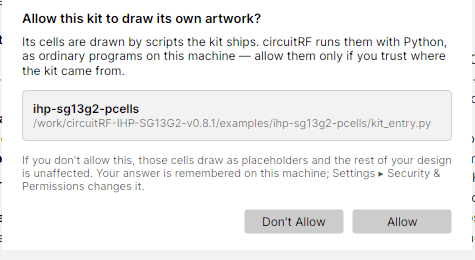
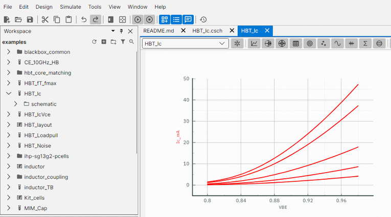
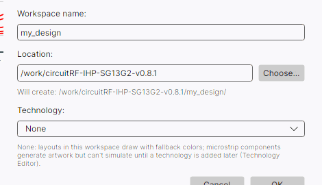
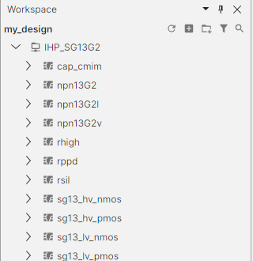
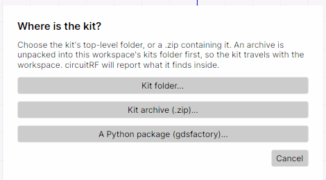
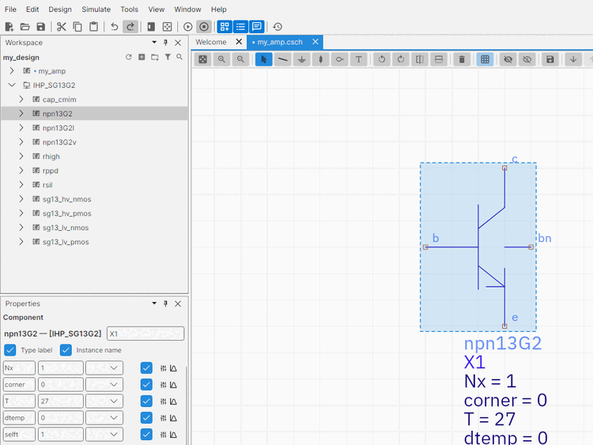
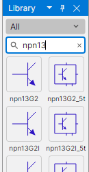
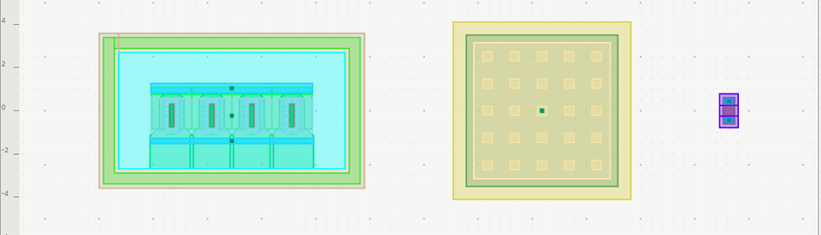
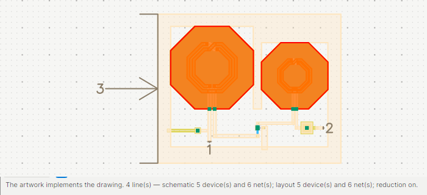

# Getting Started: the IHP SG13G2 Kit in circuitRF

This guide takes you from an empty computer to a simulated SiGe HBT in a workspace of your own. Each step was
checked on circuitRF 1.9.2 with kit v0.8.1.

## What You Get

- **The kit** (`kit/IHP_SG13G2/`): circuitRF cells for the SG13G2 devices, with the PDK's corners and
  temperature:
  - the HBTs `npn13G2`, `npn13G2l` and `npn13G2v`;
  - the MOSFETs;
  - the poly resistors;
  - the MIM capacitor.

  Their models come compiled for Windows, Linux and Intel macOS.
- **The technology** (`kit/IHP_SG13G2/tech/IHP_SG13G2.ctech`): the layers and the stackup for layout and EM.
- **The examples** (`examples/`): benches ready to run: I–V curves, fT, load-pull, noise, a VCO and an inductor
  in EM.
- **Optional, the IHP PDK itself**, imported by circuitRF. It brings IHP's layout PCells and the PDK's other
  devices: inductors, diodes, pads and more.

## 1. Install

1. **circuitRF** 1.8.4 or newer, from its [releases](https://github.com/potatobeanradio/circuitRF/releases):
   `.msi` for Windows, `.dmg` for macOS, AppImage, `.deb` or `.tar.gz` for Linux.
2. **The kit:** `circuitRF-IHP-SG13G2-<version>.zip` from the kit's
   [releases](https://github.com/aissus/circuitRF-IHP-SG13G2-PDK/releases). Unpack it anywhere, and keep its
   folders together: `examples/` finds the kit as `../kit`.
3. **Only for layout and the PDK's own parts:**
   - the [IHP Open PDK](https://github.com/IHP-GmbH/IHP-Open-PDK), at the commit `kit/IHP_SG13G2/BUILD` names;
   - Python 3.10 or newer.

   [IIC-OSIC-TOOLS](https://github.com/iic-jku/IIC-OSIC-TOOLS) has both, with the PDK at `/foss/pdks/ihp-sg13g2`.
4. **Only on an Arm computer** (Apple Silicon, Arm Linux, Windows on Arm): run `generator/build-vbic.sh` once.
   It needs [OpenVAF](https://fides.fe.uni-lj.si/openvaf/). On every other computer the models are already
   compiled.

## 2. Try the Examples

1. **File ▸ Open Workspace…** and select the `examples` folder. The picker chooses folders: select the folder
   itself, not a file in it.
2. circuitRF asks whether the kit may draw its own artwork. This means running IHP's PCell scripts with Python.
   - Choose **Allow** if you trust where the kit came from.
   - **Don't Allow** only draws the layouts as placeholders.
   - **Settings ▸ Security & Permissions** changes the answer later.

   

3. In the Workspace panel, right-click **HBT_Ic** ▸ **Open Schematic**, then press **Run** (▶ in the toolbar).
   The plot shows Ic against VBE for five sizes.

   

The other benches run the same way, and `examples/README.md` says what each one shows. Two notes:

- **The PDK's location.** The examples look for the PDK at `/foss/pdks/ihp-sg13g2`. With it elsewhere, run
  `circuitrf import pdk <PDK folder> --into examples` once. Without the PDK the benches still simulate; only
  the layouts draw as placeholders.
- **The two EM black-boxing examples** (`inductor_coupling/`, `hbt_core_matching/`) are workspaces of their own.
  Make each one first with `generator/circuitrf-ihp-workspace examples/<name>` (Linux, macOS).

## 3. Start Your Own Design

### From the Menus (Windows, macOS, Linux)

1. **New workspace.** **File ▸ New Workspace…**: give it a name and a folder, and set **Technology** to
   **None**. IHP is not in that list; step 3 adds it.

   

2. **Add the kit.** **File ▸ Reference Workspace…**, select the folder `kit/IHP_SG13G2`, keep the name
   `IHP_SG13G2`, then OK. The kit's cells appear in the Workspace panel. The reference stores the kit's full
   path, so if you move the kit, reference it again.

   

3. **Add the technology** (for layout and EM):
   1. With your file manager, make a `tech` folder in your workspace and copy
      `kit/IHP_SG13G2/tech/IHP_SG13G2.ctech` into it.
   2. Press the Workspace panel's refresh button (⟳).
   3. Right-click `IHP_SG13G2.ctech` ▸ **Set as Workspace Default**.
4. **Optional, import the PDK** (for IHP's layout PCells and the PDK's other devices): **File ▸ Import ▸ PDK…** ▸
   **Kit folder…**, and select the PDK's `ihp-sg13g2` folder.

   

   - The report says **Partially imported**. That is normal: the PDK also holds files circuitRF does not read,
     such as test benches for other simulators.
   - **Allow** the kit to draw its artwork, as in section 2.
   - When asked to build a technology from the PDK, choose **Not Now**. Step 3's technology is the one the
     examples were checked with.
5. **Make a cell and place devices.**
   1. The **+** button at the top of the Workspace panel makes a new cell (Template **(Empty)**) and opens its
      schematic.
   2. Drag a device from **IHP_SG13G2** in the Workspace panel onto the schematic.
   3. Set its parameters (Nx, corner, T, …) in the Properties panel.
   4. Add sources, ports and grounds from the Library panel on the right, and analyses from the **Analyses**
      tab.

   

   Quicker: start from an example bench.
   1. Copy its folder (for example `examples/HBT_Ic`) into your workspace folder with your file manager.
   2. Press refresh (⟳), and edit the copy.

> [!IMPORTANT]
> **HBTs: place the kit's cells.** After a PDK import, the Library panel also lists the PDK's own `npn13G2`,
> `npn13G2l` and `npn13G2v`, shown below. Those simulate only in a workspace made by the script below, and
> only on Linux. Place the HBTs from **IHP_SG13G2** in the Workspace panel instead: they simulate on every
> platform.
>
> 

### With the Script (Linux, macOS)

```bash
generator/circuitrf-ihp-workspace my_project
```

This one command:

- does steps 1 to 4 above;
- references the kit by a relative path, so the kit and the workspace can move together;
- declares the kit's VBIC model to stand in for the PDK's own HBTs, so those simulate too.

It needs `circuitrf` on `PATH` (check with `circuitrf --version`) and `python3`. It finds the PDK in this order:
`$IHP_PDK`, `$PDKPATH`, then `/foss/pdks/ihp-sg13g2`.

## 4. From Schematic to Layout

The same kit cells you simulate are drawn by IHP's own PCells, at each instance's values. This needs the
circuitRF release after 1.9.2, and the PDK imported into your workspace with its artwork allowed (section 3,
step 4, or the script).

1. **Update Layout from Schematic** (**Design** menu, or Ctrl+U) in the cell's schematic. Each kit cell is
   placed as its IHP PCell: an `npn13G2` at its Nx, a `cap_cmim` at its w and l, an `rsil` at its w and l.
   Move the parts where you want them.

   

2. **Draw the connections** in metal: traces between the pins, and via stacks between metal levels. The
   technology from section 3 step 3 has the layers.
3. **LVS:** open the layout, then **LVS ▸ Compare**. It pairs each kit cell with the PCell drawn for it and
   checks every net. The HBTs' substrate pin `bn` and the MOSFETs' bulk pin `b` are not in the PCells' artwork,
   so LVS notes them and leaves them out.

   

4. **EM:** an EM setup can cut the devices out and put their models back on the cut ports. The
   `examples/hbt_core_matching` README walks through this on a matched HBT stage.

Changing a value in the schematic and running Update Layout again redraws that part at the new value.

## 5. Which Part for What

| You need | Use | From |
|---|---|---|
| An HBT | `npn13G2`, `npn13G2l`, `npn13G2v` | **IHP_SG13G2** in the Workspace panel |
| A MOSFET | `sg13_lv_nmos`, `sg13_lv_pmos` (1.2 V), `sg13_hv_nmos`, `sg13_hv_pmos` (3.3 V) | the same |
| A resistor or MIM capacitor | `rsil`, `rppd`, `rhigh`, `cap_cmim` | the same |
| An inductor, diode, pad or other PDK device | the PDK's parts | the Library panel, after **Import ▸ PDK…** |
| Layout | the same kit cells, drawn as IHP's PCells | **Update Layout from Schematic** (section 4) |
| EM | `IHP_SG13G2.ctech` | section 3, step 3 |

**Parameters:**

- `corner`: 0 is typical, 1 best case, 2 worst case. For the MOSFETs these are tt, ff and ss.
- `T` is the temperature in °C. 27 is the PDK's nominal.
- Lengths are in metres, as in the PDK.

## 6. If Something Goes Wrong

- **An HBT bench fails and names `vbic_1p3_5t.osdi`.** Your computer has no compiled VBIC model, which is the
  case on Arm. Run `generator/build-vbic.sh` once.
- **Layouts draw as grey placeholders.** The kit's artwork was not allowed. Change that in
  **Settings ▸ Security & Permissions**.
- **The PDK's `npn13G2` from the Library does not simulate.** Use the kit's cell (section 5), or make the
  workspace with the script, on Linux.
- **Update Layout skips a kit cell,** saying it "is drawn by the generator …, which is not registered in this
  workspace". The PDK is not imported here, or its artwork was not allowed: section 3, step 4.
- **On Windows, a model fails to load with a missing `VCRUNTIME140.dll`.** Install Microsoft's Visual C++
  Redistributable (x64).
- **circuitRF 1.9 warns about a thermal node** that "reaches its reference only through 1.14E+04 °C/W, which is
  not a thermal resistance". It appears on a small HBT and is harmless:
  - 1.14E+04 °C/W is the PDK's own self-heating resistance for one `npn13G2` at Nx = 1;
  - it is just above the limit circuitRF 1.9 checks against;
  - the results are the same as on 1.8.4.
- **Folder pickers in circuitRF 1.9.2:**
  - Click through the folders rather than typing a path. The picker completes names as you type, and a path
    that ends up not existing can close circuitRF.
  - **File ▸ Add Cell to Workspace…** copies the cell next to the workspace, not into it. Copy bench folders
    with your file manager instead.

## More

- [The kit's README](../README.md): the cells, the technology, and how the kit is built and validated.
- [`examples/README.md`](../examples/README.md): what each bench shows, and how to run them all from the command
  line.
