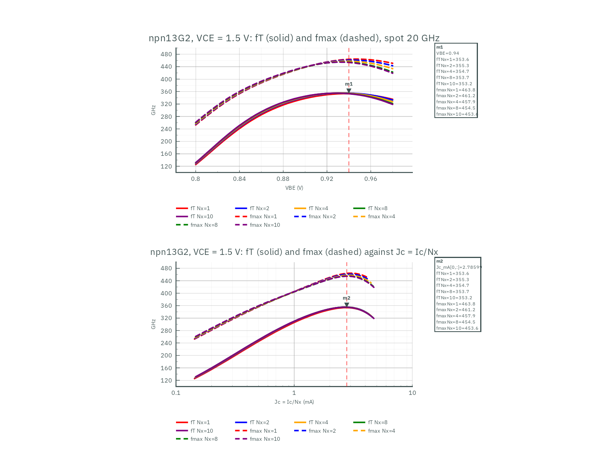
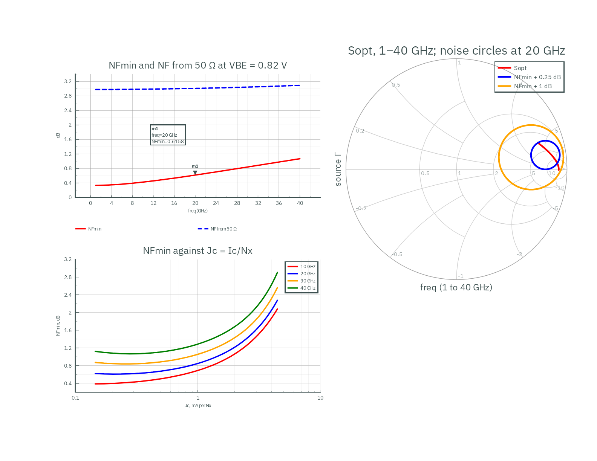
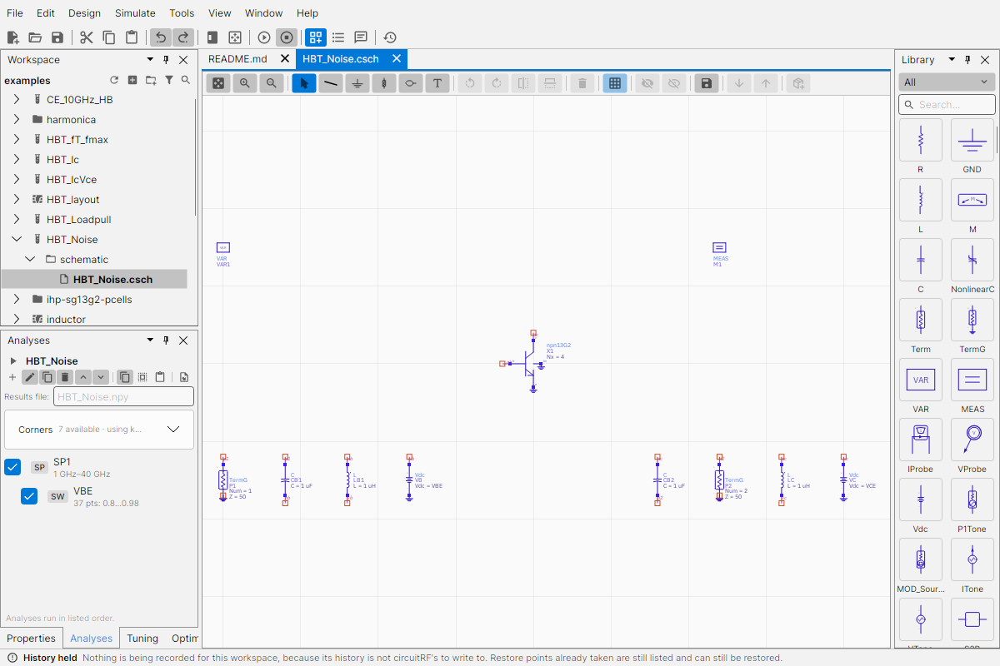
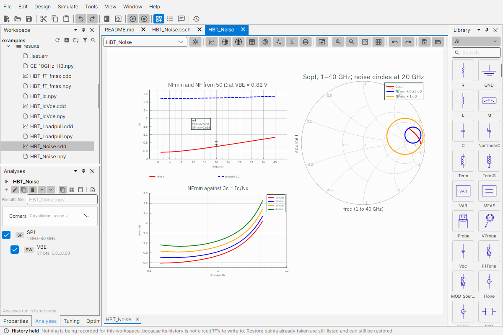
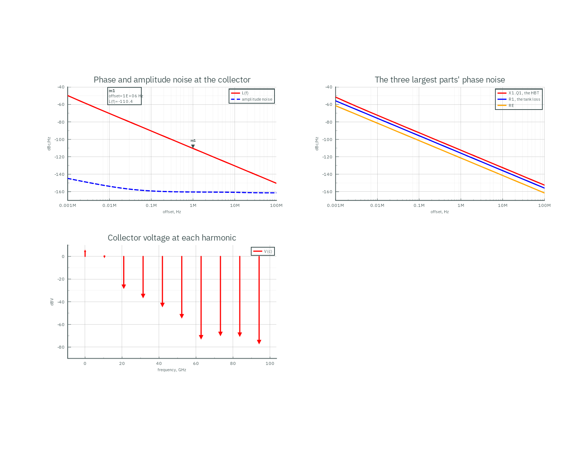
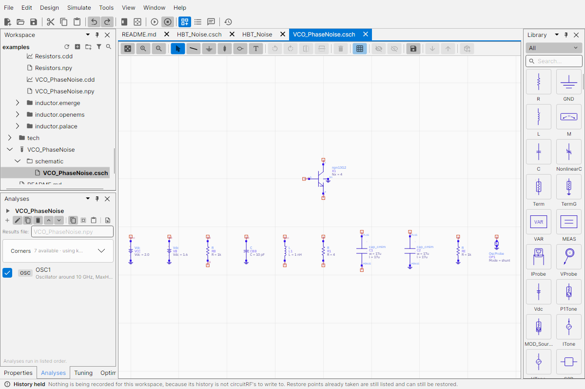
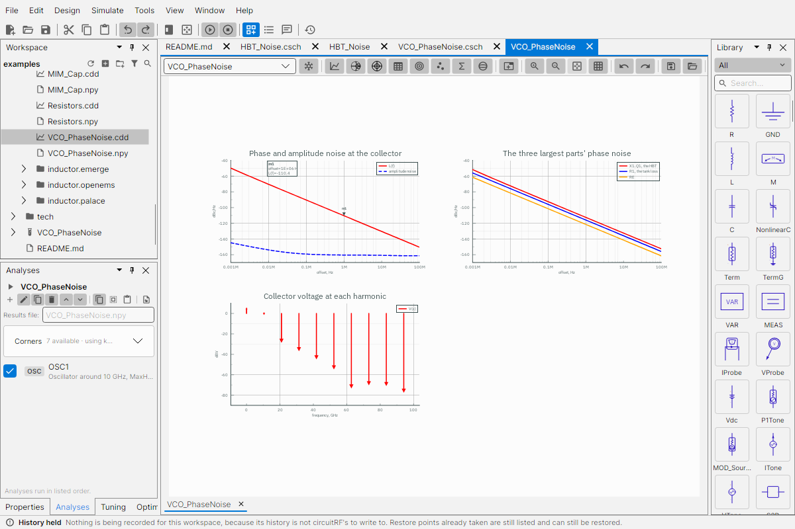
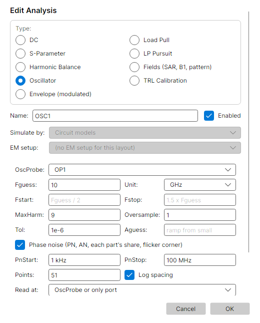

# Example workspace

Test benches on the IHP SG13G2 kit. This folder is one circuitRF workspace; its benches place the cells
of `../kit/IHP_SG13G2`.

- **From a release:** run `generator/build-vbic.sh` once, for the HBTs' VBIC model.
- **From the repository:** build the kit with `./kit.sh generator/build.sh`. The build also writes this
  workspace's copy of the technology (`tech/`) and its harmonicaRF documents (`harmonica/`).

Open `examples/.cws` with File ▸ Open Workspace in circuitRF 1.8.0 or newer, or with
`./kit.sh circuitrf examples/.cws` in the repository.

| Bench | What it shows | Ported from |
|---|---|---|
| `HBT_IcVce` | npn13G2 (Nx=1) output curves: Ic against VCE from 0 to 1.5 V, VBE 0.80 to 0.90 V | Qucs-S `dc_hbt_13g2` |
| `Resistors` | rsil, rppd and rhigh (10 µm wide) at the wcs corner: V/I from 0 to 10 V | Qucs-S `resistors` |
| `MIM_Cap` | cap_cmim 70 × 70 µm: C and Q from 100 kHz to 300 GHz | Qucs-S `ac_mim_cap` |
| `HBT_fT_fmax` | npn13G2 fT and fmax against VBE at VCE = 1.5 V, for Nx = 1, 2, 4, 8, 10 | |
| `HBT_Ic` | the same bias network and Nx × VBE grid at DC: Ic, and Jc = Ic/Nx, the x-axis of the Jc plot | |
| `HBT_Loadpull` | npn13G2 (Nx=8) load-pull at 50 GHz: Pout and PAE contours at 1 dB compression | |
| `CE_10GHz_HB` | npn13G2 common emitter at 10 GHz: an HB drive sweep, with Pout, Gt, H2 and H3 measured | |
| `HBT_Noise` | npn13G2 (Nx=4) noise parameters from 1 to 40 GHz against VBE: NFmin, Sopt, Rn and noise circles | |
| `VCO_PhaseNoise` | a 10.46 GHz Colpitts VCO on npn13G2 and two MIM capacitors: its oscillation and phase noise | |
| `inductor` | a two-turn TopMetal2 inductor from IHP's PCell: its layout, its 3D view, and one EM setup per solver | IHP's `inductor2` PCell |
| `inductor_TB` | the inductor's series L and Q from every EM run, side by side | |
| `Kit_cells` | every kit cell, placed as in the PDK's Qucs-S symbol gallery, with the status of every Qucs-S component | Qucs-S `symbols.sch` |
| `HBT_layout` | IHP's npn13G2 PCell at Nx = 1, 4 and 8, with a 3D view on the SG13G2 stack | IHP KLayout PCells |
| `harmonica/` | harmonicaRF documents: npn13G2 and npn13G2v at Nx = 1, 2, 4, 8, at 50 GHz (written by the build) | |

## Running them

From the repository's top folder:

```bash
./kit.sh bash -c 'cd examples &&
  circuitrf hb HBT_IcVce/schematic/HBT_IcVce.csch -a SW2 -o results/HBT_IcVce.npy &&
  circuitrf hb Resistors/schematic/Resistors.csch -a SW1 -o results/Resistors.npy &&
  circuitrf sparam MIM_Cap/schematic/MIM_Cap.csch -o results/MIM_Cap.npy &&
  circuitrf hb HBT_Ic/schematic/HBT_Ic.csch -a SW0 -o results/HBT_Ic.npy &&
  circuitrf hb HBT_fT_fmax/schematic/HBT_fT_fmax.csch -a SW0 -o results/HBT_fT_fmax.npy &&
  circuitrf hb CE_10GHz_HB/schematic/CE_10GHz_HB.csch -a SW -o results/CE_10GHz_HB.npy &&
  circuitrf lp HBT_Loadpull/schematic/HBT_Loadpull.csch -o results/HBT_Loadpull.npy &&
  circuitrf hb HBT_Noise/schematic/HBT_Noise.csch -a SW0 -o results/HBT_Noise.npy &&
  circuitrf osc VCO_PhaseNoise/schematic/VCO_PhaseNoise.csch -o results/VCO_PhaseNoise.npy'
```

The longest run, the load-pull, takes about 20 s; the noise sweep and the oscillator take a few seconds each.
Each verb runs the whole parametric sweep that wraps its analysis, and `-a <sweep>` names the sweep. In the
GUI, press Simulate on a bench as usual.

Each bench's data display (`results/<bench>.cdd`) reads the `.npy` its run writes. Every axis of every
plot autoscales to all its traces, and a marker reads the curves where it matters:

| Display | Marker m1 |
|---|---|
| `HBT_IcVce` | Ic at VCE = 1 V |
| `Resistors` | each resistor's V/I at 5 V |
| `MIM_Cap` | C and Q at 1 GHz |
| `HBT_fT_fmax` | every Nx at VBE = 0.94 V (the peak), and m2 at the peak Jc |
| `inductor_TB` | L and Q of every solver at 10 GHz |
| `HBT_Noise` | NFmin at 20 GHz |
| `VCO_PhaseNoise` | the phase noise at 1 MHz from the carrier |

The inductor's L plot shows EMerge's self-resonance near 40 GHz in full. The three resistors share
one axis. The pictures below are these displays, from `docs/make-figures.sh`, on white.

Every existing bench gives the same numbers on circuitRF 1.8.0 as on 1.7.5.

Against the same benches run on circuitRF 1.6.0 with the kit's previous build:
- **Six benches are identical** in every number: everything except the load-pull.
- **The load-pull** converges at 5 more of its 1,568 drive points (the lowest drives at two loads) and
  agrees within 0.09 dB in Pout and Gt where both converged. That change is circuitRF's load-pull
  engine between those versions, not the kit.

## Libraries

The workspace references two libraries:

- **IHP_SG13G2**, the kit, at `../kit/IHP_SG13G2`. The `.cws` names it twice:
  - as a library, so it appears in the Workspace tree and the palette;
  - under the alias `IHP_SG13G2`, which is how the benches place its cells (`ws://IHP_SG13G2/npn13G2`).
  Moving the kit means changing those two paths.
- **ihp-sg13g2**, the PDK itself, imported by circuitRF from `/foss/pdks/ihp-sg13g2` (where the image
  has it; a `.cws` cannot take a variable there).
  - It appears in File ▸ Manage Libraries and in the palette: 216 parts from IHP's xschem symbols and
    ngspice models, the corner libraries, and IHP's KLayout PCells (declared in `ihp-sg13g2-pcells/`).
    `circuitrf import pdk` wrote both records; with the PDK elsewhere, run it again with that path.
  - circuitRF translates these parts itself. The build checks its MOSFETs, resistors, MIM capacitor and
    HBTs against ngspice too (the `pdk://` rows of the kit's `VALIDATION`).
  - Its HBTs name ngspice's built-in VBIC, which circuitRF does not have. They run where the `.cws`
    declares the kit's VBIC 1.3 to stand in for it, as `generator/circuitrf-ihp-workspace` does; this
    workspace does not, because that declaration names an absolute path. Its benches use the kit's cells.

## fT and fmax

`HBT_fT_fmax` biases npn13G2 through ideal bias tees (1 H, 1 F) at VCE = 1.5 V. It steps Nx over 1, 2, 4,
8 and 10 (sweep SW0), and inside that VBE from 0.80 to 0.98 V (SW1). At each point it runs an S-parameter
analysis at one spot frequency, f0 = 20 GHz (a VAR, so it can be changed). The spot frequency sits in the
−20 dB/decade region of h21 and U, so:

    fT   = |h21|·f0,     h21 = -2·S21 / ((1-S11)(1+S22) + S12·S21)
    fmax = sqrt(U)·f0,   U = |S21/S12 - 1|² / (2·(K·|S21/S12| - Re(S21/S12)))   (Mason)

| Nx | 1 | 2 | 4 | 8 | 10 |
|---|---|---|---|---|---|
| peak fT (GHz) | 354 | 356 | 355 | 355 | 355 |
| peak fmax (GHz) | 464 | 461 | 458 | 455 | 455 |

The peaks sit at VBE = 0.93 to 0.945 V; for Nx = 1 that is Ic ≈ 2.8 mA. IHP publishes 350 GHz fT and
450 GHz fmax for SG13G2. The PDK model run directly in ngspice (Nx = 1, VBE = 0.94 V) gives fT = 356 GHz
at Ic = 2.788 mA, against the kit's 354 GHz at 2.786 mA.

The display has two plots, with fT solid and fmax dashed, one colour per Nx:
- **Against VBE**, read directly from `HBT_fT_fmax`.
- **Against Jc = Ic/Nx on a log axis**, the usual way to compare sizes: the five curves fall on top of each
  other, peaking at Jc ≈ 2.8 mA per emitter. An S-parameter run carries no DC currents, so `HBT_Ic` runs
  the same grid at DC, and each trace takes its x values from `Jc_mA` in `results/HBT_Ic.npy`. Run both
  benches after a change.

Markers m1 and m2 read every trace at the same x. Drag one and all ten values in its box follow.



## Noise parameters

`HBT_Noise` biases npn13G2 (Nx = 4) through ideal bias tees (1 µH, 1 µF) between two 50 Ω ports at
VCE = 1.5 V, and steps VBE from 0.80 to 0.98 V (SW0), the grid of `HBT_Ic`. At each VBE an S-parameter
analysis with noise (`Noise=yes`) runs from 1 to 40 GHz. It writes the noise figure from port 1's 50 Ω (`NF`),
the noise parameters (`NFmin`, `Sopt`, `Rn`, `Zopt`), the noise temperatures (`Te`, `Tmin`) and each part's share
of the noise (`NFpct`). Two measurements draw noise circles: `ns_circle(SP1.S, SP1.NFmin + 0.25)` and
`ns_circle(SP1.S, SP1.NFmin + 1)`.

| Frequency | 10 GHz | 20 GHz | 30 GHz | 40 GHz |
|---|---|---|---|---|
| Lowest NFmin | 0.39 dB | 0.61 dB | 0.84 dB | 1.07 dB |
| at VBE (Ic) | 0.80 V (0.58 mA) | 0.81 V (0.81 mA) | 0.82 V (1.11 mA) | 0.82 V (1.11 mA) |

The current for the lowest NFmin rises with frequency and stays far below the current of the fT peak
(11.2 mA at Nx = 4, at VBE = 0.935 V). At 10 GHz NFmin is still falling at the low end of the grid. At
VBE = 0.82 V and 20 GHz, NFmin is 0.62 dB with Sopt = 0.86 ∠ 9° (Zopt = 319 + j338 Ω) and Rn = 49 Ω, so
the noise figure from 50 Ω is 3.0 dB: the device wants a high source impedance, which an input match would
have to provide. The bench runs at circuitRF's default ambient and the HBT cell at its default T = 27 °C,
while the noise figure is referred to T0 = 290 K.

The display shows NFmin and NF from 50 Ω at VBE = 0.82 V, Sopt over the band with the two noise circles
at 20 GHz, and NFmin against Jc = Ic/Nx at 10, 20, 30 and 40 GHz. Like the fT plot, the last takes its
x values from `results/HBT_Ic.npy`. The build checks the same noise analysis on npn13G2 Nx = 1, as
a cell and as the PDK's part, and on the PDK's sg13_lv_nmos against ngspice (the noise rows of
`VALIDATION`).





## Phase noise

`VCO_PhaseNoise` is a common-base Colpitts oscillator on npn13G2 (Nx = 4):
- the tank: 1 nH from VCC = 2 V to the collector, with 4 Ω of loss (Q ≈ 16 at 10 GHz);
- the capacitive divider: two `cap_cmim` of 17 × 17 µm (436 fF each), collector to emitter and emitter
  to ground;
- the bias: RE = 1 kΩ, and the base at 1.6 V through 1 kΩ, decoupled by 10 pF;
- an OscProbe across the tank (`Mode=shunt`).

Its oscillator analysis (`type=osc`, `Fguess` = 10 GHz, `MaxHarm` = 9, `PhaseNoise=yes` from 1 kHz to
100 MHz) finds the oscillation at 10.456 GHz with 0.84 V of fundamental at the collector, in a few seconds. The
phase noise comes from the circuit's own noise sources over the large-signal waveform:

| Offset | 1 kHz | 10 kHz | 100 kHz | 1 MHz | 10 MHz | 100 MHz |
|---|---|---|---|---|---|---|
| L(f), dBc/Hz | −49.8 | −70.4 | −90.4 | −110.4 | −130.4 | −150.4 |

- **The slope** is 20 dB per decade from 10 kHz up. At 1 kHz the HBT's flicker noise adds 0.5 dB.
- **`PNcorner` stays empty**, and the run says why in a warning. The compiled VBIC reports its noise as
  one density, so the analysis cannot split off the flicker part. `PN` includes it.
- **At 1 MHz**, 62 % of the phase noise comes from the HBT, 28 % from the tank's 4 Ω and 8 % from RE
  (`PNpct`).

The build checks the oscillation against an ngspice transient on a validation circuit: the bench with
each MIM as an ideal 436.2 fF plus 55 mΩ in place of the `cap_cmim` cells. With the same compiled VBIC 1.3
in both, that circuit oscillates at 10.4564 GHz in circuitRF and at 10.4563 GHz in ngspice (0.0007 %),
with a collector fundamental of 0.840 V against 0.841 V (0.18 %). The bench itself, with the `cap_cmim`
cells, finds the 10.456 GHz above. There is no open reference for the phase noise. For an estimate,
Leeson's formula with the tank's Q, the 0.33 mW in the tank and a noise factor of 1 gives −122 dBc/Hz at
1 MHz: the result corresponds to an effective noise factor of 11.6 dB.

The display shows L(f) and the amplitude noise at the collector, the three largest parts' phase noise,
and the collector voltage at each harmonic. Right-click the L(f) trace's legend entry and choose **Copy
as Phase-Noise Mask** to carry this phase noise onto a source in an envelope run.






## The other benches


In `HBT_Loadpull`, VBE = 0.74 V biases the HBT close to class B, so its gain rises with drive before it
compresses. At 50 Ω, Gt goes from −2.7 dB at −20 dBm to +11.2 dB at −2 dBm. Keep that in mind when reading the
1 dB compression contours, or raise VBE for a class-A bench.

### harmonicaRF

Open a document with `./kit.sh circuitrf examples/harmonica/npn13G2_Nx4_50GHz.charm`, or Tools ▸
harmonicaRF ▸ File ▸ Open.
- **The device** is the kit's `models/osdi/npn13G2.osdi`: VBIC 1.3 compiled with IHP's scaling inside, so
  its row shows only Nx, corner (0 typ, 1 bcs, 2 wcs) and temp. Change Nx and the device rescales.
- **The bias** starts at VBE 0.74 V and VCE 1.6 V, with the Nx = 8 match scaled by 8/Nx.
- **Why the build writes them:** a `.charm` names its compiled device by absolute path. circuitRF uses
  that path as the device's identity, so the documents are made for wherever the kit was built.

Make others with `./kit.sh generator/harmonica_ihp.py charm <out.charm> --device npn13G2l --nx 6 --vbe 0.8
--vce 2.0 --f 94e9`.

## Differences from the Qucs-S originals

- `HBT_IcVce` steps VBE where Qucs-S steps IB: circuitRF has no DC current source.
- `MIM_Cap` uses an S-parameter sweep where Qucs-S uses AC: circuitRF has no AC analysis.
  C = −1/(ω·Im Z11).
- Parts the kit does not have are left out: the ptap/ntap body ties (the resistor bodies go to ground
  instead), and cap_rfcmim.

## The inductor

`inductor/inductor_from_pcell.py` draws the inductor with IHP's own `inductor2` PCell:
- two turns of 5.4 µm TopMetal2 at 4.1 µm spacing;
- the smallest centre opening the PCell allows for them (62.63 µm, so 92.5 µm across);
- both terminals on TopMetal1.

It writes two layouts:

```bash
./kit.sh klayout -b -r examples/inductor/inductor_from_pcell.py
```

| Layout | For | Ports |
|---|---|---|
| `inductor.clay` | the 3D solvers (Palace, EMerge, openEMS) | one lumped port on each terminal, down to a 20 µm Metal1 ring 22 µm clear of the coil |
| `inductor_mom.clay` | circuitRF's planar MoM | a TopMetal1 bar joins the two terminals, and one internal delta-gap port cuts it in the middle |


**Why the planar MoM gets its own layout.** The planar kernel returns every port to the
technology's ground, which here is the backside, 750 µm below. It also de-embeds an edge port by
solving calibration lines beside the structure. For this coil those lines would need 167 GB, and
their feeds must be clear of other metal by several substrate heights, which two terminals 9.5 µm
apart can never be. (circuitRF says both, and refuses the run.) A delta-gap port needs neither: it is a
cut with metal on both sides. So the MoM measures the coil differentially, terminal to terminal, and
the bar adds a few pH of its own.


`inductor_TB` compares the runs on that same footing. Each 3D run's 2-port gives its differential
impedance, and the MoM's 1-port is that impedance directly:

    Zdiff = Z11 + Z22 - Z12 - Z21 = 2·Z0·(1 - S11·S22 + S12·S21 - S12 - S21) / ((1 - S11)(1 - S22) - S12·S21)
    L = Im(Zdiff) / ω,   Q = Im(Zdiff) / Re(Zdiff)

Run the EM setups first, then the bench:

```bash
./kit.sh circuitrf em examples/inductor/em/inductor_palace.cem    # also _emerge, _mom
./kit.sh bash -c 'cd examples && circuitrf sparam inductor_TB/schematic/inductor_TB.csch -o results/inductor_TB.npy'
```

Differential L and Q on circuitRF 1.7.3, each solver at the setup's own settings (16 cores, on a
shared machine):

| Run | 2 GHz | 10 GHz | 20 GHz | 30 GHz | 40 GHz | Time |
|---|---|---|---|---|---|---|
| Palace (second-order elements, no refinement) | 448 pH, Q 1.9 | 436 pH, Q 7.4 | 467 pH, Q 11.5 | 538 pH, Q 12.7 | 691 pH, Q 11.3 | 1 h 18 min, 222,122 unknowns |
| circuitRF planar MoM | 583 pH, Q 2.1 | 583 pH, Q 8.7 | 601 pH, Q 13.0 | 646 pH, Q 15.6 | 727 pH, Q 16.1 | 2 h, 13,211 unknowns |
| EMerge (circuitRF's default mesh) | 337 pH, Q 1.5 | 338 pH, Q 5.4 | 411 pH, Q 7.1 | 679 pH, Q 5.3 | past resonance | 28 s, 5,616 tetrahedra |


How to read it:
- **The MoM and the 3D runs do not solve quite the same structure.** The 3D layout has the Metal1 ring,
  a closed loop 22 µm around the coil, which acts as a shorted turn. Cutting it with a 5 µm slit
  raises EMerge's L by 13 % at 2 GHz and 16 % at 10 GHz. The MoM layout has no ring: at the 1.35 µm
  grid the coil's 5.4 µm lines need, meshing the ring is far past what one machine holds.
- **Palace without the ring's effect** would read about 505–510 pH. The modified Wheeler formula
  (Mohan et al., 1999) gives 521 pH for the coil alone, without its leads. The MoM reads about 15 %
  above that corrected Palace value. Its sheet conductors (no metal thickness) and the bar can account
  for part of it; this comparison does not separate them.
- **Q** rises the same way on both up to 20 GHz. The MoM's is higher, partly because there is no ring to
  lose energy to.
- **EMerge** at circuitRF's default mesh reads L about 25 % low and resonates early. It needs a finer
  mesh for features this small in a thick substrate.

`inductor_openems.cem` is the same model for openEMS. On this coil its grid has 1.8 million cells, and the
0.2 µm cell its finest feature needs sets 1.8 million time steps per port, which circuitRF estimates at about
9 hours. FDTD on micrometre features at GHz is the expensive case. It is not in the comparison.
