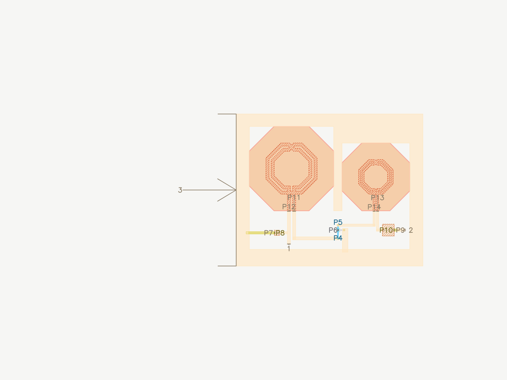
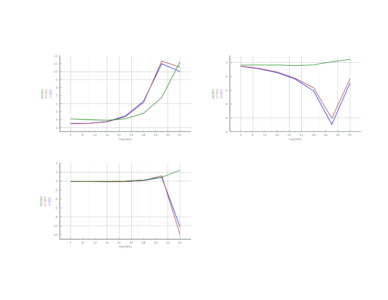

# hbt_core_matching: an HBT core whose matching coils are kept in the EM or cut out

A single-finger IHP SG13G2 `npn13G2` (Nx = 1) in common emitter, matched in and out by the two `inductor2` coils of
`../inductor_coupling`, at the same 75 µm spacing and in the same TopMetal1 ground plane. circuitRF 1.8.4's planar
solver solves the layout twice. In `core_i` the transistor and the two MIM capacitors are cut out, and the coils,
lines and plane are in the EM. In `core_ii` the two coils are cut out too, and the co-simulation puts each
coil's own model back. The amplifier's S-parameters and stability, the one against the other, show what the
coupling and the interconnect the black-boxed coils lose do to it. `PORTS.md` says what every port of every result is.



## The circuit

P1 → C1 (8 × 8 µm cmim, shunt to the plane) → L1 (the big coil, series) → Q1 base. Q1's emitter goes up a via stack
onto a finger of the plane. Q1 collector → L2 (the small coil, series) → C2 (20 × 20 µm cmim, DC block) → P2. Drawn
port 3 is the plane's tie. The matching aims at the 20–30 GHz band and is not optimised: a 0.6 nH coil cannot
resonate out a single-finger base, so the input stays poorly matched. Bias: VBE = 0.88 V, VCE = 1.5 V
(1.17 mA collector current, from the bare transistor at that bias).

## What is in this folder

| Cell / file | What it is |
|---|---|
| `IND_BIG`, `IND_SMALL` | The coil cells of `../inductor_coupling`, written by the same shared code: same PCells, same own EM setups (`ind_big`, `ind_small`), same 2-port models. `results/ind_*` are copies of that folder's runs; rerunning the setups here gives the same files (the runs are deterministic) |
| `CORE` | The circuit above. Layout: the coils at `inductor_coupling`'s positions, the plane, Q1 (`npn13G2` PCell), C1 and C2 (`cmim` PCells), TopMetal1 routes with via stacks down to Q1's Metal1 and Metal2 pins. Schematic: the same parts, L1 and L2 as the coil cells. EM setups `core_i` and `core_ii` |
| `make_core.py` | Writes the cells above (shared code: `../blackbox_common/blackbox.py`) |
| `compare.py` | The S-parameter and stability table, and `core.cdd` |
| `PORTS.md` | The port map, written by `../blackbox_common/portmap.py` |
| `results/`, `tb/`, `pictures/` | The runs' results, the benches, the pictures |

**Which instances are cut in which setup:**

| Setup | Cut (Component ports) | In the EM | Ports |
|---|---|---|---|
| `core_i` | `Q1`, `C1`, `C2` | both coils, the plane, the routes and via stacks | 1 in, 2 out, 3 the tie; 4–6 `Q1.C`, `Q1.B`, `Q1.E`; 7–10 `C1.PLUS`, `C1.MINUS`, `C2.PLUS`, `C2.MINUS` |
| `core_ii` | `Q1`, `C1`, `C2`, `L1`, `L2` | the plane, the routes and via stacks | the same 1–10, and 11–14 `L1.LB`, `L1.LA`, `L2.LB`, `L2.LA` |

The co-simulation puts back the kit's `npn13G2` on Q1's pins, the kit's `cap_cmim` on C1's and C2's, and in `core_ii`
each coil's own 2-port (`IND_BIG`, `IND_SMALL`) on its lead faces.

## Prerequisites

- **circuitRF 1.8.4 or newer**: cutting out cell instances (`ComponentPorts` naming a kit transistor, a PCell) and
  drawn ports marked `"PortUncalibrated": true` are 1.8.4's.
- **`compare.py display`** draws its one plot with `circuitrf plot --trace …,file=<result>`, each trace reading its
  own result, which needs circuitRF built from `main` at c855f0b7d or later, until the next release. Everything else
  here runs on 1.8.4.
- **The kit**, built in this repository with its image: `./kit.sh generator/build.sh`. `./kit.sh <command>` runs a
  command in the image from the repository's top folder; every path below is relative to that folder.
- **The workspace.** This folder is a circuitRF workspace of its own. Its `.cws`, technology copy and PCell
  declaration name this machine's paths, so the repository does not store them. The kit's build makes them, or:

  ```bash
  ./kit.sh generator/circuitrf-ihp-workspace examples/hbt_core_matching   # IHP technology, the kit, the PDK, PCells
  ```

  The cells, EM setups, benches and results are stored. `make_core.py` writes the cells and setups again:
  `./kit.sh bash -c 'cd examples/hbt_core_matching && python3 make_core.py'`.

  The PCells are IHP's own KLayout code. The GUI asks once whether to allow it; on the command line every command
  that draws a layout takes `--trust-kit ihp-sg13g2-pcells`. The kit's compiled VBIC model must be built
  (`generator/build-vbic.sh`), as for every HBT in the kit.

## In the GUI

1. **Open the workspace**: `./kit.sh circuitrf examples/hbt_core_matching/.cws` from the repository's top folder,
   or File ▸ Open Workspace. Allow the kit's PCell code when asked.
2. **Open the layout**: `CORE` ▸ layout. The coils sit in the plane's two clearances; the core is in the channel
   below them, with port 1 at the bottom of L1's left lead, port 2 at the right end of the output line and port 3 on
   the plane's left edge.
3. **See the cut**: open the EM setup `CORE/em/core_i`. Under **Component ports ▸ Cell instances**, `Q1`, `C1` and
   `C2` are ticked; open `core_ii` and `L1` and `L2` are ticked as well. The layout hatches each cut instance and puts
   an arrow at each pin's face. **Check** posts each pin's class (all routed) to Messages. Ticking or unticking `L1`
   and `L2` is the switch between the two setups.
4. **Run the EM**: Simulate `core_i` and `core_ii`. Each makes a `_cosim` cell: the result with every cut instance's
   model back on its ports.
5. **The benches**: open `core_i_cosim` or `core_ii_cosim` and Simulate it to see the raw co-simulation (all ports in
   50 Ω, no bias). The biased benches are `tb/core_i_tb.cnl` and `tb/core_ii_tb.cnl` (below): they hold the bias at
   Q1's pins through 1 mH, because the EM block has no 0 Hz point, and short the tie.
6. **The comparison**: after `compare.py display` (below), open `core.cdd`: |S21|, |S11| and |S22| of (i), (ii)
   and the schematic.

## On the command line

Every command below runs in this folder inside the image. From the repository's top folder:

```bash
k() { ./kit.sh bash -c "cd examples/hbt_core_matching && $*"; }
```

```bash
# what each cut builds, and its picture
k circuitrf explain CORE/em/core_ii.cem --component-ports --trust-kit ihp-sg13g2-pcells
k circuitrf render CORE/layout/CORE.clay --component-ports CORE/em/core_ii.cem --solver-geometry \
    -o pictures/core_ii_cut.png --trust-kit ihp-sg13g2-pcells
# the coil models: copy them from ../inductor_coupling/results, or run them here
k circuitrf em IND_BIG/em/ind_big.cem --trust-kit ihp-sg13g2-pcells
k circuitrf em IND_SMALL/em/ind_small.cem --trust-kit ihp-sg13g2-pcells
# the EM runs: (i) and (ii); each writes <setup>_cosim.cnl
k circuitrf em CORE/em/core_i.cem --trust-kit ihp-sg13g2-pcells
k circuitrf em CORE/em/core_ii.cem --trust-kit ihp-sg13g2-pcells
# the same cut for one command without editing a setup (em takes the flag too, and writes that setup's result)
k circuitrf explain CORE/em/core_i.cem --component-ports Q1,C1,C2,L1,L2 --trust-kit ihp-sg13g2-pcells
# the benches: bias at Q1's pins, DC blocks on P1 and P2, the tie shorted; and the schematic with ideal wires
k python3 ../blackbox_common/tb.py core_i_cosim.cnl tb/core_i_tb.cnl --core --grid 4,40,7
k python3 ../blackbox_common/tb.py core_ii_cosim.cnl tb/core_ii_tb.cnl --core --grid 4,40,7
k 'circuitrf netlist CORE/schematic/CORE.csch > tb/core_sch.cnl && python3 ../blackbox_common/tb.py tb/core_sch.cnl tb/core_sch_tb.cnl --core --grid 4,40,7'
k circuitrf sparam tb/core_i_tb.cnl -o results/core_i_tb.s2p
k circuitrf sparam tb/core_ii_tb.cnl -o results/core_ii_tb.s2p
k circuitrf sparam tb/core_sch_tb.cnl -o results/core_sch_tb.s2p
# the table, the display and the port map
k python3 compare.py display
k python3 ../blackbox_common/portmap.py CORE/em/core_i.cem CORE/em/core_ii.cem
```

## Results

Everything lands in `results/` (Touchstone, `.cemr` record, `_em.npy`), plus `core_i_cosim.cnl`,
`core_ii_cosim.cnl` and the `_cosim` cells the runs make. The repository keeps the Touchstone files and the
benches; the runs write the rest again. The biased benches are in `tb/`; their 2-ports are
`results/core_{i,ii,sch}_tb.s2p`. `tb.py` names the kit's compiled VBIC model relative to each bench, so the stored
benches run as they are. `compare.py` prints the table below; `compare.py display` draws `core.cdd` and
`pictures/core.png`. The EM points are 4, 10, 16, 22, 28, 34 and 40 GHz, on the coils' own 3 GHz grid.

| | 4 GHz | 10 GHz | 16 GHz | 22 GHz | 28 GHz | 34 GHz* | 40 GHz* |
|---|---|---|---|---|---|---|---|
| \|S21\|, (i) coils in the EM | 3.51 dB | 3.54 | 3.76 | 4.47 | 6.30 | 10.99 | 10.02 |
| \|S21\|, (ii) coils cut | 3.51 dB | 3.53 | 3.74 | 4.37 | 6.13 | 11.33 | 10.56 |
| \|S21\|, schematic | 4.10 dB | 4.00 | 3.94 | 4.10 | 4.80 | 6.79 | 11.20 |
| \|S11\|, (i) / (ii) | −0.27 / −0.26 | −0.44 / −0.42 | −0.73 / −0.68 | −1.20 / −1.14 | −2.05 / −1.82 | −4.47 / −4.03 | −1.48 / −1.17 |
| \|S22\|, (i) / (ii) | −0.08 / −0.09 | −0.12 / −0.11 | −0.13 / −0.11 | −0.09 / −0.11 | +0.14 / +0.14 | +0.85 / +1.21 | −10.2 / −11.9 |
| μ, (i) / (ii) | 0.84 / 0.88 | 0.79 / 0.83 | 0.83 / 0.86 | 0.87 / 0.89 | 0.89 / 0.89 | 0.82 / 0.76 | 0.66 / 0.53 |
| K, (i) / (ii) | 0.16 / 0.13 | 0.25 / 0.24 | 0.36 / 0.36 | 0.46 / 0.49 | 0.51 / 0.51 | 0.39 / 0.38 | 0.68 / 0.67 |

\* circuitRF flags the 34 and 40 GHz rows of both EM results as not passive (σmax up to 1.13): not to be read.

How to read it:

- **Up to 28 GHz the black-boxed coils cost little**: (ii) is within 0.1 dB of (i) in S21 up to 22 GHz and 0.17 dB
  below it at 28 GHz; S11 is within 0.06 dB up to 22 GHz and 0.23 dB at 28 GHz, and S22 within 0.02 dB. The coupling
  (k about −1 %, `../inductor_coupling`) and the plane round the coils move this stage by at most a few tenths of a
  dB. Above 28 GHz the rows are not passive and say nothing.
- **At the low end the interconnect costs more than the coupling**: the schematic (the same models, ideal wires, no
  plane) has 0.5–0.6 dB more gain than either EM run at 4–10 GHz, and a different input match.
- **The stage is potentially unstable in all three** (μ < 1, K < 1 at every point): the matching is rudimentary
  and nothing stabilises the single finger. Black-boxing the coils does not change that verdict.



### The port map

`PORTS.md` has one table per EM result, built the same way as in `../inductor_coupling`: index and `Pnn` name, the
drawn label or cut pin, the schematic net, what the port returns through, calibration, and the `_cosim` node with the
model terminal on it. Each table is followed by circuitRF's own header lines and the one-line-per-port form, which circuitRF
built from `main` writes into the result itself (for a 1.8.4 result, `portmap.py` adds it). From `core_ii`:

```
! Port 4 = P04  Q1.C      net=c      ref=ground  uncalibrated
! Port 5 = P05  Q1.B      net=b      ref=ground  uncalibrated
! Port 6 = P06  Q1.E      net=0      ref=ground  uncalibrated
! Port 11 = P11  L1.LB     net=b      ref=ground  uncalibrated
! DC: none, the lowest row is 4 GHz
```

Q1's emitter is on net 0 in the schematic but is a port of its own in the EM: it reaches the reference through the
via stack, the plane and port 3, so that path is in the answer.

### Run times

On a shared machine, 8 threads per run, three runs at a time: `core_i` 139 min (22,460 unknowns, 7 points),
`core_ii` 56 min (14,390 unknowns). The coil runs are `../inductor_coupling`'s (4 min each). Each bench takes a
second.

## Known limits

- **The mesh rule.** Every setup, the coils' own runs included, meshes on the plain tensor grid (`"LocalGrid": false`
  in its `PlanarMesh`, written by `../blackbox_common/blackbox.py`). circuitRF 1.8.4's default local grid sizes its
  base blocks from the sweep's top frequency; on the 1–40 GHz sweep that read the big coil's L 14 % high from 10 to
  16 GHz (`../inductor_coupling`, Known limits). On those coil models (ii) read 0.9 dB more gain than (i) at
  28 GHz; on the tensor grid it reads 0.17 dB less. The tensor grid costs 1.4 to 1.5 times the unknowns. On
  circuitRF built from `main` the tensor grid is unchanged to within 2 pH (`../inductor_coupling`, Known limits).
- C1 and C2 are cut in both setups because of mesh size: as copper, their Vmim arrays mesh to about 51,000 unknowns
  on 1.8.4. circuitRF built from `main` merges each Vmim array into one region, which takes `core_i` with both caps
  in to 48,753 unknowns (79 GB a point), still too big for an example.
- There is no DC row, so the bias is held at Q1's pins through 1 mH. The benches' ICC and IB are not the device's.
- The 34 and 40 GHz rows are not passive. The cause is the uncalibrated ports, grounded through about 760 µm of
  silicon: past a quarter wavelength in the substrate (about 29 GHz) they are no longer short, and circuitRF built
  from `main` warns about it.
- Planar only on this die: in 3D, each cut port is a lumped sheet down to the backside, about 755 µm tall. A cut
  entry's `"Return"` (circuitRF `main`) needs metal drawn across the pin's face, and this layout has none there.
- Ports are uncalibrated and return to the backside; the plane reaches it only through port 3, which the bench shorts.
