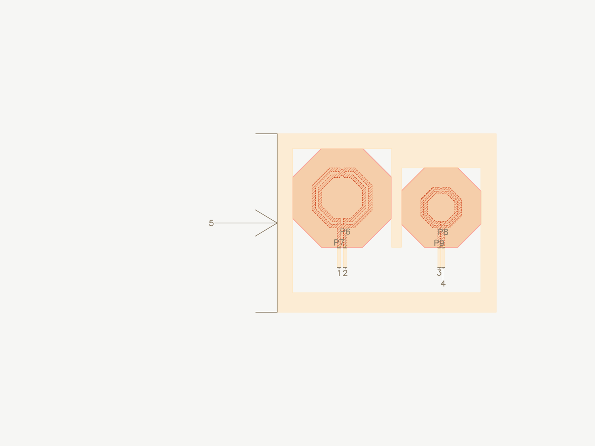
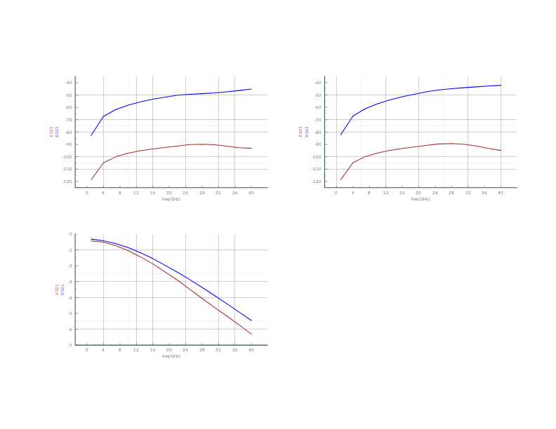

# inductor_coupling: two IHP inductors, kept in the EM or cut out

Two IHP SG13G2 `inductor2` spirals of different size sit 75 µm apart, coil edge to coil edge, in a TopMetal1
ground plane. circuitRF 1.8.4's planar solver solves the same layout twice: once with both coils in the EM
(`pair_B`), and once with both coils cut out as component ports (`pair_A`), where the co-simulation netlist puts
each coil's own model back on its leads. What `pair_A` loses against `pair_B` is the coupling a black box cannot
see: coil to coil, and coil to plane. `PORTS.md` says what every port of every result is.

The PDK has no schematic model for `inductor2`, so each coil's own EM run is its model. `../hbt_core_matching` uses
the same two coils, plane and spacing as the matching of an HBT core.



## What is in this folder

| Cell / file | What it is |
|---|---|
| `IND_BIG` | `inductor2`, 2 turns, w 5.4 µm, s 4.1 µm, d 62.63 µm (the kit example's coil, 92.5 µm across). Layout: the PCell alone, a drawn port on each lead. EM setup `ind_big`. Schematic: that run's 2-port between pins `LA` and `LB` |
| `IND_SMALL` | `inductor2`, 2 turns, w 4 µm, s 2.1 µm, d 35 µm (62.6 µm across). The same three views, EM setup `ind_small` |
| `PAIR` | L1 (`IND_BIG`'s PCell) and L2 (`IND_SMALL`'s) in a TopMetal1 plane that clears each coil's IND keep-out; a 30 µm TopMetal1 feed on each lead with drawn ports 1–4, and port 5 on the plane's left edge (the tie). EM setups `pair_B` and `pair_A`. Schematic: P1–P4 with L1 and L2 as the two coil cells |
| `make_coupling.py` | Writes the cells above (shared code: `../blackbox_common/blackbox.py`) |
| `compare.py` | The L, Q and coupling tables, and `coupling.cdd` |
| `PORTS.md` | The port map, written by `../blackbox_common/portmap.py` |
| `results/`, `tb/`, `pictures/` | The runs' results, the benches, the pictures |

**Which instances are cut in which setup:**

| Setup | Cut (Component ports) | In the EM | Ports |
|---|---|---|---|
| `ind_big`, `ind_small` | nothing | the coil alone | 1, 2 at the lead ends |
| `pair_B` | nothing | both coils, the plane, the feeds | 1–4 on the feeds, 5 the tie |
| `pair_A` | `L1`, `L2` (by name) | the plane and the feeds | 1–5, and 6–9 at the four lead faces (`L1.LB`, `L1.LA`, `L2.LB`, `L2.LA`) |

## Prerequisites

- **circuitRF 1.8.4 or newer**: cutting out cell instances (`ComponentPorts` naming a PCell instance) and drawn
  ports marked `"PortUncalibrated": true` are 1.8.4's.
- **The kit**, built in this repository with its image: `./kit.sh generator/build.sh`. `./kit.sh <command>` runs a
  command in the image from the repository's top folder; every path below is relative to that folder.
- **The workspace.** This folder is a circuitRF workspace of its own. Its `.cws`, technology copy and PCell
  declaration name this machine's paths, so the repository does not store them. The kit's build makes them, or:

  ```bash
  ./kit.sh generator/circuitrf-ihp-workspace examples/inductor_coupling   # IHP technology, the kit, the PDK, PCells
  ```

  The cells, EM setups, bench and results are stored. `make_coupling.py` writes the cells and setups again:
  `./kit.sh bash -c 'cd examples/inductor_coupling && python3 make_coupling.py'`.

  The PCells are IHP's own KLayout code. The GUI asks once whether to allow it; on the command line every command
  that draws a layout takes `--trust-kit ihp-sg13g2-pcells`.

## In the GUI

1. **Open the workspace**: `./kit.sh circuitrf examples/inductor_coupling/.cws` from the repository's top folder,
   or File ▸ Open Workspace. Allow the kit's PCell code when asked.
2. **Open the layouts**: `PAIR` ▸ layout shows the two coils, the plane, the four feeds with ports 1–4 and port 5 on
   the plane's left edge. `IND_BIG` and `IND_SMALL` ▸ layout are each coil alone.
3. **See the cut**: open the EM setup `PAIR/em/pair_A`. Under **Component ports ▸ Cell instances**, `L1` and `L2`
   are ticked; the layout hatches each cut coil and puts an arrow at each lead's face. **Check** posts each pin's
   class (all four routed) to Messages. `pair_B` has nothing ticked: ticking or unticking `L1` and `L2` is the
   switch between the two.
4. **Run the EM**: Simulate `ind_big` and `ind_small` first (their 2-ports are the models `pair_A` puts back),
   then `pair_B` and `pair_A`.
5. **The co-simulation**: `pair_A`'s run makes the cell `pair_A_cosim`, the 9-port with each coil's model on its
   lead faces. Open its schematic and Simulate.
6. **The comparison**: after `compare.py display` (below), open `coupling.cdd`: |S31| (L1.LA to L2.LA), |S42|
   (L1.LB to L2.LB) and |S21| (through L1) of `pair_B` against `pair_A`, the tie port shorted in both.

## On the command line

Every command below runs in this folder inside the image. From the repository's top folder:

```bash
k() { ./kit.sh bash -c "cd examples/inductor_coupling && $*"; }
```

```bash
# what the cut builds, and its picture
k circuitrf explain PAIR/em/pair_A.cem --component-ports --trust-kit ihp-sg13g2-pcells
k circuitrf render PAIR/layout/PAIR.clay --component-ports PAIR/em/pair_A.cem --solver-geometry \
    -o pictures/pair_A_cut.png --trust-kit ihp-sg13g2-pcells
# the EM runs: the two coils alone (the models), then the pair both ways
k circuitrf em IND_BIG/em/ind_big.cem --trust-kit ihp-sg13g2-pcells
k circuitrf em IND_SMALL/em/ind_small.cem --trust-kit ihp-sg13g2-pcells
k circuitrf em PAIR/em/pair_B.cem --trust-kit ihp-sg13g2-pcells
k circuitrf em PAIR/em/pair_A.cem --trust-kit ihp-sg13g2-pcells        # writes pair_A_cosim.cnl
# the same cut on pair_B for one command, without editing the setup (em takes the flag too, and then
# writes over pair_B's own result)
k circuitrf explain PAIR/em/pair_B.cem --component-ports L1,L2 --trust-kit ihp-sg13g2-pcells
# the benches: pair_A's co-simulation, and the schematic (the two models alone, no plane)
k circuitrf sparam pair_A_cosim.cnl -o results/pair_A_cosim.s5p
k 'circuitrf netlist PAIR/schematic/PAIR.csch > tb/pair_sch.cnl && python3 ../blackbox_common/tb.py tb/pair_sch.cnl tb/pair_sch_tb.cnl'
k circuitrf sparam tb/pair_sch_tb.cnl -o results/pair_sch.s4p
# the tables, the display and the port map
k python3 compare.py display
k python3 ../blackbox_common/portmap.py IND_BIG/em/ind_big.cem IND_SMALL/em/ind_small.cem PAIR/em/pair_B.cem PAIR/em/pair_A.cem
```

## Results

Everything lands in `results/` (Touchstone, `.cemr` record, `_em.npy`), plus `pair_A_cosim.cnl` and the cells
`pair_A_cosim` and `pair_B_sim` that the runs make. The repository keeps the Touchstone files only; the runs write
the rest again. `compare.py` prints the table below and writes the tie-shorted
4-ports `results/pair_{B,A}_tie.s4p` (without the bad 19 GHz row, Known limits); `compare.py display` draws them
as `coupling.cdd` and `pictures/coupling.png`.

How each number is taken: port 5 (the tie) and the far end of each coil (ports 2 and 4) are shorted to the reference,
which leaves the 2-port of ports 1 and 3, one end of each coil. L = Im(Z11)/ω and Q = Im(Z11)/Re(Z11) for L1 (Z22
for L2), k = Im(Z12)/√(Im Z11 · Im Z22). |S31| is L1.LA to L2.LA with only the tie shorted and the other ports in
50 Ω. B is `pair_B`, A is `pair_A`'s co-simulation, S is the `PAIR` schematic (the two coil models and nothing
else, so k = 0 by construction). The L values include the two 30 µm feeds (S has no feeds).

| | 1 GHz | 4 GHz | 10 GHz | 16 GHz | 22 GHz | 28 GHz | 34 GHz | 40 GHz |
|---|---|---|---|---|---|---|---|---|
| **k**, B (coils in the EM) | −0.0074 | −0.0078 | −0.0083 | −0.0091 | −0.010 | −0.012 | −0.013 | −0.014 |
| **k**, A (coils cut) | −3e−6 | −3e−6 | −8e−6 | −2e−5 | −3e−5 | −4e−5 | −5e−5 | −4e−5 |
| **\|S31\|**, B | −82.6 dB | −67.3 | −58.2 | −53.4 | −50.2 | −48.9 | −47.4 | −45.2 |
| **\|S31\|**, A | −118.7 dB | −104.9 | −97.1 | −93.7 | −91.3 | −89.8 | −91.4 | −93.2 |
| L1 / Q1, B | 612 pH / 1.1 | 610 / 4.0 | 621 / 8.2 | 649 / 10.6 | 699 / 11.6 | 784 / 11.6 | 933 / 10.5 | 1217 / 8.2 |
| L1 / Q1, A | 599 / 0.7 | 661 / 3.5 | 681 / 7.3 | 710 / 9.1 | 762 / 9.5 | 841 / 9.6 | 992 / 10.2 | 1282 / 9.2 |
| L1 / Q1, S | 585 / 0.7 | 647 / 3.5 | 665 / 7.3 | 690 / 9.2 | 733 / 9.7 | 797 / 9.9 | 917 / 10.9 | 1133 / 10.3 |
| L2 / Q2, B | 437 / 0.8 | 435 / 2.9 | 437 / 6.1 | 444 / 8.1 | 459 / 9.4 | 484 / 10.2 | 522 / 10.4 | 578 / 10.0 |
| L2 / Q2, A | 386 / 0.6 | 425 / 2.7 | 431 / 6.0 | 437 / 8.1 | 449 / 9.4 | 467 / 10.3 | 497 / 11.2 | 541 / 11.5 |
| L2 / Q2, S | 372 / 0.6 | 412 / 2.8 | 417 / 6.1 | 421 / 8.2 | 431 / 9.6 | 445 / 10.5 | 469 / 11.6 | 504 / 12.1 |

How to read it:

- **The coupling is the black box's blind spot.** With both coils in the EM, k is about −0.8 % at 10 GHz and
  −1.4 % at 40 GHz, and L1.LA to L2.LA is −58 dB at 10 GHz, −45 dB at 40 GHz. With both coils cut, what is left
  (the feeds and the plane alone) is about 40 dB lower, k below 5·10⁻⁵. Almost all of the coupling is coil to coil
  and coil to plane, and a cut removes it. The sign of k follows the two coils' winding and lead order.
- **L moves too.** In the plane, L1 reads 621 pH at 10 GHz against 681 pH cut out (−9 %), and its Q is higher;
  L2 moves less. Part of that is the plane round each coil, a shorted turn; part is mesh (Known limits).
- **The schematic, S, is A without the feeds and the plane**: A − S is the feeds' 14–29 pH up to 22 GHz.
- At 1 GHz circuitRF's planar kernel drives an edge port against ground (series gaps from 3.6 GHz up); the coils'
  own runs, and so A and S, step by about 10 % between 1 and 4 GHz where B does not.
- **The notch A would show at 19 GHz is not real.** `ind_big.s2p`, the big coil's own run and so the model A and S
  put back, reads |S21| −16.5 dB at 19 GHz between −1.8 dB (16 GHz) and −2.8 dB (22 GHz); `ind_small.s2p` has a bad
  19 GHz row too. `pair_A`'s own EM (plane and feeds, −0.01 dB from feed to lead face) and `pair_B` are smooth there,
  and S, the model alone, shows the same notch, so it is neither the cut nor the co-simulation's mapping. Re-solving
  the coil on 17–21 GHz gives a bad row at 18 GHz as well (deterministic, also on one core), and shifts the good
  rows by up to 10 %. `compare.py` leaves 19 GHz
  out of the table and of the files the display draws.



### The port map

`PORTS.md` has one table per EM result. Each row is a port: its index in the Touchstone and a name `Pnn`; what it
is, a drawn label (with the schematic Term it is linked to) or a cut pin `instance.pin` with its class from
`explain --component-ports`; the schematic net it is on; what it returns through (here every port returns through
the backside, the stackup's ground); calibrated or uncalibrated; and, for a run with cut instances, the node of
`<setup>_cosim.cnl` on it and the model terminal circuitRF put there. Under each table are circuitRF's own header
lines and, for comparison, the same information one line per port as this example proposes. From `pair_A`:

```
! Port 5 = P05  5         net=plane  ref=ground  uncalibrated
! Port 6 = P06  L1.LB     net=b1     ref=ground  uncalibrated
! Port 7 = P07  L1.LA     net=a1     ref=ground  uncalibrated
! DC: none, the lowest row is 1 GHz
```

`portmap.py` reads only circuitRF's outputs and the layout's links to the schematic. A drawn label with no Term
(the tie, or a lead port of a coil alone) is named by where it sits: on a PCell's pin face, or on the plane.

### Run times

On a shared machine, 8 threads per run: `ind_big` 4 min, `ind_small` 4–9 min, `pair_A` 5 min, `pair_B` 66 min
(11,464 unknowns, 14 points). The co-simulation and the bench take a second each.

## Known limits

- The 19 GHz row of each coil's own run is a known solver artefact; it is dropped from the table and the display.
- There is no DC row (the lowest is 1 GHz), and rows from 31–34 GHz up are flagged as not passive: do not read them.
- Planar only on this die: in 3D, each cut port is a lumped sheet down to the backside, about 755 µm tall.
- Ports are uncalibrated and return to the backside; edge mesh is off, so Q reads low.
- L and Q of A against B include a mesh difference (coil alone, coil in the pair); k and |S31| are the result.
